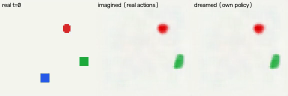

<div align="center">

# mini-WAM

</div>

mini-WAM is a minimal, beginner-friendly World Action Model (WAM). It shows how a robot policy can fuse images, text instructions and robot states to produce continuous actions, *and* predict what those actions will do to the world: the next state and the next image.

> [!IMPORTANT]
> it is far from being production-ready! Purpose? Education. A VLA learns `image_t + language + state_t → action_t`; mini-WAM learns `image_t + language + state_t → action_t + state_t+1 + image_t+1`. (Inspired by, and extending, [mini-VLA](https://github.com/keivalya/mini-vla).)

<div align="center">
  
  <br>
  <em>left: the real episode · middle: what mini-WAM imagines, given the real actions · right: what it dreams when its own policy acts inside its imagination</em>
</div>

This project intentionally keeps the codebase small (~700 LOC for the core model) so that,
- beginners coming from VLAs can understand the complete WAM training and imagination pipeline
- researchers can rapidly prototype new ideas around latent world models
- students can *look inside* a world model: decode what it imagines, ask it "what if I pushed left?", and probe what its latent space encodes

> [!TIP]
> I recommend reading the following to get started with the mini-WAM implementation.
> - Prediction Is Not Yet Control: An Empirical Audit of a Small World–Action Model — [PDF](docs/paper/mini-wam-paper.pdf) · [LaTeX source](docs/paper/mini-wam-paper.tex) · [Research plan](docs/paper/RESEARCH_PLAN.md)
> - Blog: Building a World Action Model from scratch (Basics) — **TBD**
> - Blog: From VLAs to WAMs (Math, Code, and Intuition) — **TBD**

This project is not meant to be state-of-the-art. Instead, it provides a clear, hackable template for understanding WAM design.

The mini-WAM core is a VLA-style policy with a world model on top:
- [models/encoders.py](models/encoders.py) encodes images (TinyCNN or spatial-softmax keypoints), text and robot states
- [models/fusion.py](models/fusion.py) combines them with an MLP into one latent world state `z_t`
- [models/action_heads.py](models/action_heads.py) turns `z_t` into an action (MLP, diffusion, or flow matching)
- [models/dynamics_head.py](models/dynamics_head.py) holds the world model: `LatentDynamicsMLP` predicts `z_t+1` from `(z_t, a_t)`, and a *linear* `StateReadout` reads the physical state back out of any latent
- [models/image_decoder.py](models/image_decoder.py) turns any latent, real or imagined, back into an image
- [models/losses.py](models/losses.py) adds up the action, state, image and latent-consistency losses
- [models/wam_policy.py](models/wam_policy.py) combines everything, including `imagine()` to roll the world forward in latent space

Additionally, I provide scripts:
- [scripts/collect_data.py](scripts/collect_data.py) collects data with an expert policy, plus a few random-action bursts so the world model learns what actions do
- [scripts/train.py](scripts/train.py) trains the WAM (or a VLA baseline without the world model, `--model_type vla`)
- [scripts/evaluate.py](scripts/evaluate.py) measures how well the WAM imagines held-out futures, including counterfactual "what if" actions
- [scripts/visualize_rollout.py](scripts/visualize_rollout.py) shows what the world model believes (imagination strips, latent maps, what-if plots, keypoints)
- [scripts/test.py](scripts/test.py) tests the policy in sim and saves "mind's eye" videos
- [scripts/run_toy.sh](scripts/run_toy.sh) runs the full pipeline over three seeds


# Video

**TBD**: a video walkthrough of mini-WAM is coming soon.

## Getting started

Create (or activate) a conda environment

```
conda create --name mini-wam python=3.11
conda activate mini-wam
```

Clone mini-WAM project

```
git clone https://github.com/keivalya/mini-wam.git
cd mini-wam
```

Install dependencies

```
pip install -r requirements.txt
```

## Collect demonstration data

This gathers trajectories with an expert policy in a tiny 2D toy world (numpy only, seconds on a laptop) and saves them in a `.npz` dataset. 30% of the time, the expert hands over to a short burst of random actions, so the world model sees actions the expert would never take.

```
python -m scripts.collect_data \
  --env toy \
  --episodes 400 \
  --max-steps 80 \
  --output-path data/toy.npz
```

> [!TIP]
> For Meta-World, use `--env metaworld --env-name push-v3 --camera-name corner` (images are resized to 64×64 when collecting).

## Train your WAM model

Train the policy and the world model together on your collected dataset.

```
python -m scripts.train \
  --dataset-path data/toy.npz \
  --model_type wam \
  --action_head mlp \
  --predict_state \
  --predict_image \
  --epochs 15 \
  --save-path checkpoints/wam.pt \
  --device cpu
```

Train a VLA baseline (same encoders, no world model) on the same data with `--model_type vla` (and drop `--predict_state --predict_image`).

## Test your model in sim

Run the trained WAM in the toy world on unseen seeds. With `--save-video`, every frame shows the real observation next to what the model believes now and what it expects a few steps ahead.

```
python -m scripts.test \
  --checkpoint checkpoints/wam.pt \
  --episodes 20 \
  --device cpu \
  --save-video \
  --video-dir videos
```

## Look inside the world model

Measure how well it imagines held-out futures (and "what if" futures under random actions), then visualize what it believes.

```
python -m scripts.evaluate --checkpoint checkpoints/wam.pt
python -m scripts.visualize_rollout --checkpoint checkpoints/wam.pt --video
```

## Research evidence and reproduction

The [revised paper](docs/paper/mini-wam-paper.pdf) distinguishes archived neural results from fresh diagnostics. The [research plan](docs/paper/RESEARCH_PLAN.md) reviews novelty, confounds, and top-tier venue requirements.

The original experiment launcher remains available as `scripts/run_toy.sh`. **It deletes the root `results/` directory when starting**, so run it only in an isolated checkout. Original training datasets and checkpoints are not included in the local archive.

Run the fresh five-seed dynamics audit with:

```sh
python3 scripts/research_audit.py --seeds 5 --output docs/results/research-audit
```

The [audit protocol and results](docs/results/research-audit/README.md) show why persistence alone is insufficient as a baseline: a structured affine predictor fits this toy's dynamics to numerical precision, including from deterministic expert data. The archived pixel-input policy gain remains promising but is confounded by privileged state supervision. A matched supervision pilot is implemented in `scripts/supervision_ablation.py`, with an Explorer launcher in `scripts/hpc/`.

## Inference (coming soon)

Planning to,
- plan with the world model: imagine candidate action sequences and pick the best (MPC)
- run the full study on Meta-World — **TBD**
- a standalone inference script with arbitrary text input — **TBD**
- blogs, tutorials and a video walkthrough — **TBD**
