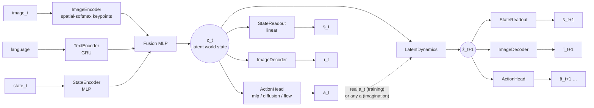

# mini-WAM: Building a World Action Model from Scratch

**Keivalya Pandya**, Northeastern University

*A tutorial written as a research paper. Code: this repository. Companion to [mini-VLA](https://github.com/keivalya/mini-vla).*

---

## Abstract

Vision-Language-Action models (VLAs) map an image, an instruction and the robot state to an action. They learn *what to do*, but nothing in their training asks them *what will happen* when they do it. World Action Models (WAMs) add that second question: the same network that picks the action must also predict the next state of the world.

In this paper I build the smallest WAM I could make that still behaves like one, called **mini-WAM**. It starts from mini-VLA and adds three things: an action-conditioned latent dynamics model, a *linear* readout that turns any latent back into a physical state, and an image decoder that turns it back into a picture. Everything (the policy, the dynamics and the readouts) runs on one shared latent vector, so the model can "imagine" many steps ahead and we can *look at* what it imagines.

I train mini-WAM on a toy 2D world that runs on a laptop, and study it the way you would study a real model: three seeds per experiment, held-out episodes, and a counterfactual test against the true simulator. *[Results summary goes here once the runs finish.]*

All of mini-WAM is about 1,000 lines of PyTorch. The point is not state-of-the-art numbers. The point is that you can read every line, change one thing, and see what the world model learned.

---

## 1. Introduction

If you have trained a VLA, or just read mini-VLA, you know the recipe: encode the image, encode the instruction, encode the robot state, fuse them, and regress (or diffuse) an action.

```text
mini-VLA:   image_t + language + state_t → action_t
```

That recipe works surprisingly well, but it is *reactive*. A recent survey of World Action Models puts it like this:

> "Despite this progress, most VLA policies remain primarily reactive. They are typically trained to map the current observation, a short history, and a task instruction to the next action, without explicitly modeling how alternative actions would change future observations, physical states, or task progress" ([Survey](https://www.alphaxiv.org/abs/2609.16074))

A World Action Model keeps the VLA's job and adds a second one:

```text
mini-WAM:   image_t + language + state_t → action_t + state_t+1 + image_t+1
```

The same survey defines WAMs as "predictive control models that connect future-state modeling with executable action generation" ([Survey](https://www.alphaxiv.org/abs/2609.16074)). Today's WAMs are large: video diffusion backbones, billions of parameters, and robot datasets that most of us cannot train on. That makes it hard to build intuition. What does the "world model" part actually learn? When does it help? What breaks?

This paper is my attempt to answer those questions at a scale where you can watch everything happen. My contributions are:

1. **A minimal WAM** (§3). mini-VLA plus three small modules: latent dynamics, a linear state readout and an image decoder, all on one shared latent. Every module is a few dozen lines.
2. **A toy world built for understanding** (§4). A 2D point mass with momentum and two language-selected goals. It renders in microseconds, and its true state is six numbers, so we can check exactly what the latent encodes.
3. **Tools for looking inside** (§5.6): imagination strips, belief traces, a latent map, "what if" counterfactuals and an error-vs-horizon curve.
4. **A small but careful study** (§5). Three seeds per configuration, held-out episodes, and ablations of the data, the loss terms and the imagination horizon. It also includes the experiment that made me rethink the data: a world model trained only on expert demos *learns to ignore the action*.

> **A note on the name.** While writing this I found an unrelated paper also called *MiniWAM* ([Chen et al., 2026](https://www.alphaxiv.org/abs/2610.12194)). It is a 0.25B-parameter model that predicts compact learned future representations instead of native visual features. This project (mini-WAM, with a hyphen) is an educational from-scratch implementation and is not connected to that work.

---

## 2. Background: from VLAs to WAMs

### 2.1 What you already know, and what it becomes in a WAM

Most of a WAM is made of things you have already met somewhere else in robotics or ML. This table is the map I wish I had when I started:

| If you know… | …then in mini-WAM it is | File |
|---|---|---|
| A VLA's vision/language/state encoders + fusion | the **observation encoder** that produces the latent world state $z_t$ | `models/encoders.py`, `models/fusion.py` |
| A VLA's action head (MLP, diffusion, flow) | the **policy** $\pi(a_t \mid z_t)$, unchanged | `models/action_heads.py` |
| A forward model / simulator $s_{t+1}=f(s_t,a_t)$ from controls | the **latent dynamics** $z_{t+1}=f_\theta(z_t,a_t)$, a simulator learned in latent space | `models/dynamics_head.py` |
| A state estimator / Kalman filter output | the **state readout** $\hat s = W z + b$, which reads the physical state back out of $z$ | `models/dynamics_head.py` |
| An autoencoder's decoder | the **image decoder**, which renders any latent (real or imagined) as a picture | `models/image_decoder.py` |
| Rolling out a model in MPC | **imagination**: apply $f_\theta$ repeatedly with a chosen action sequence | `MiniWAMPolicy.imagine` |
| A linear probe in interpretability ([Alain & Bengio](https://www.alphaxiv.org/abs/1610.01644)) | the readout is *literally* a linear probe, trained jointly | `StateReadout(linear=True)` |

### 2.2 World models

The idea of learning a model of the world and acting inside it is old in control (system identification, MPC) and in RL (model-based RL). Three lines of work shaped mini-WAM:

* **World Models** ([Ha & Schmidhuber](https://www.alphaxiv.org/abs/1809.01999)) and **Dreamer** ([Hafner et al.](https://www.alphaxiv.org/abs/1912.01603)) learn a compact latent state from pixels and a dynamics model on top of it, then learn behaviour "by latent imagination". mini-WAM's `imagine()` is the same idea in its simplest form.
* **TD-MPC2** ([Hansen et al.](https://www.alphaxiv.org/abs/2310.16828)) learns a latent dynamics model for continuous control and plans with it. mini-WAM's *latent consistency* loss (the imagined latent should match the encoding of the real future observation) is in the same spirit.
* **Spatial-softmax keypoints** ([Finn et al.](https://doi.org/10.1109/icra.2016.7487173)) turn conv feature maps into $(x, y)$ coordinates. mini-WAM uses them as its image encoder because global average pooling throws away *where* things are, and a world model needs exactly that.

### 2.3 VLAs

VLAs such as RT-2 ([Brohan et al.](https://doi.org/10.48550/arxiv.2307.15818)), OpenVLA ([Kim et al.](https://www.alphaxiv.org/abs/2406.09246)) and π0 ([Black et al.](https://doi.org/10.15607/rss.2025.xxi.010)) scale the "observation + instruction → action" recipe with large pretrained backbones and large robot datasets. Their action heads (discrete tokens, diffusion ([Chi et al.](https://doi.org/10.15607/rss.2023.xix.026)), flow matching ([Lipman et al.](https://doi.org/10.48550/arxiv.2210.02747))) carry over unchanged to WAMs. mini-VLA and mini-WAM implement all three of MLP, diffusion and flow.

Interestingly, there is evidence that large VLAs may *already* contain some implicit model of state transitions: Molinari et al. probe OpenVLA's internal activations for future state changes ([Emergent World Representations in OpenVLA](https://www.alphaxiv.org/abs/2509.24559)). A WAM makes that model *explicit*, so it can be trained, tested and used directly.

### 2.4 World Action Models

The survey ([Survey](https://www.alphaxiv.org/abs/2609.16074)) separates two families:

* **Joint prediction:** one model predicts future observations *and* actions, so future prediction acts as extra supervision for the policy. Examples include unified video-action models such as UWM ([Zhu et al.](https://doi.org/10.15607/rss.2025.xxi.015)) and video-pretrained policies such as GR-1 ([Wu et al.](https://doi.org/10.48550/arxiv.2312.13139)).
* **Plan-then-act:** first predict the future (often as video), then recover the action with an inverse dynamics model. UniPi ([Du et al.](https://doi.org/10.52202/075280-0403)) is an early example.

mini-WAM is a *joint-prediction* WAM, with a twist: its dynamics model is **action-conditioned**, so it can answer "what if" questions about actions it was not shown. That matters, because predicting what actually happened is not the same as understanding actions. In AD-WM, Qiu et al. write that a model "can therefore achieve low factual prediction error yet poorly distinguish candidate actions" ([AD-WM](https://www.alphaxiv.org/abs/2609.30264)). §5.3 shows exactly this failure in a tiny model.

---

## 3. mini-WAM

### 3.1 Overview



The whole design rests on one idea: **everything lives on the same latent $z$.** The policy acts from $z$, the dynamics moves $z$ forward given an action, and the readouts turn *any* $z$, encoded from a real frame or imagined, back into a state and an image. Because the policy also reads $z$, the model can roll its own policy forward without ever touching the environment (the "dream" row in Figure 3).

### 3.2 Observation encoder → latent world state

This part is mini-VLA, nearly unchanged (`models/encoders.py`, `models/fusion.py`):

$$z_t = \mathrm{LN}\big(\mathrm{MLP}([\,e_{\text{img}}(o_t);\ e_{\text{txt}}(\ell);\ e_{\text{state}}(\tilde s_t)\,])\big) \in \mathbb{R}^{128}$$

where $\tilde s_t$ is the state normalized with dataset statistics. The one change is the image encoder: a three-layer CNN followed by a **spatial softmax** over 16 heatmaps, giving 16 $(x, y)$ keypoints plus a pooled feature vector. mini-VLA's TinyCNN with global average pooling is still available (`--image_encoder cnn`).

### 3.3 Policy head

The action head maps $z_t$ to $a_t$ and is the same as in mini-VLA: an MLP regressor, a DDPM diffusion head, or a flow-matching head (`models/action_heads.py`). All three expose `loss(actions, z)` and `sample(z)`, so the rest of the model never needs to know which head it is talking to.

> **Bug fix carried back from mini-VLA.** The original diffusion head used a linear noise schedule from $10^{-4}$ to $10^{-2}$ with $T=16$ steps. That ends at $\bar\alpha_T \approx 0.92$, which means the "fully noised" action is still 92% signal. Sampling, though, starts from pure Gaussian noise the model never saw. mini-WAM switches to the cosine schedule of [Nichol & Dhariwal](https://doi.org/10.48550/arxiv.2102.09672) ($\bar\alpha_T \approx 10^{-5}$ at $T=16$) and samples from the proper DDPM posterior.

### 3.4 Latent dynamics: a learned simulator

```python
class LatentDynamicsMLP(nn.Module):
    def forward(self, z, action):
        delta = self.net(torch.cat([z, action], dim=-1))
        return self.ln(z + delta)
```

That is the whole world model (`models/dynamics_head.py`). Two small choices matter:

* **Residual:** most of the world stays the same from one step to the next, so the network only predicts the change.
* **LayerNorm on the output:** the fused latent $z_t$ is also LayerNorm-ed, so imagined latents stay on the same scale as real ones and long rollouts don't drift off.

Imagination is just a loop:

$$\hat z_{t} = z_t,\qquad \hat z_{t+k} = f_\theta(\hat z_{t+k-1},\, a_{t+k-1}),\quad k=1,\dots,H.$$

### 3.5 Readouts: making the latent readable

* **State readout** (`StateReadout`): by default a single linear layer, $\hat s = W z + b$. If agent position and velocity can be recovered *linearly* from $z$, they are explicitly encoded there, and the rows of $W$ tell you which latent directions mean what. This is a linear probe ([Alain & Bengio](https://www.alphaxiv.org/abs/1610.01644)), trained jointly with everything else and applied to real *and* imagined latents.
* **Image decoder** (`models/image_decoder.py`): $z \to 128\times4\times4 \to$ four (upsample + conv) blocks $\to 3\times64\times64$. It predicts the *difference from the dataset's mean image*, with no sigmoid. Most pixels are static background, so the decoder starts out already drawing the background. A sigmoid output saturates, and in my first version that stalled learning completely.

### 3.6 Training objective

Each training sample is a window of $H$ steps inside one episode: $o_t, a_t, \dots, a_{t+H-1}, o_{t+1}, \dots, o_{t+H}$. With $z_t = \mathrm{enc}(o_t)$ and the imagined $\hat z_{t+k}$ from §3.4:

$$
\mathcal{L} =
\underbrace{\mathcal{L}_{\text{act}}(a_t \mid z_t)}_{\text{imitate (expert steps only)}}
+ w_s\Big(\underbrace{\|R(z_t)-\tilde s_t\|^2}_{\text{know the state now}} + \underbrace{\tfrac1H\textstyle\sum_k\|R(\hat z_{t+k})-\tilde s_{t+k}\|^2}_{\text{predict it}}\Big)
+ w_i\Big(\|D(z_t)-o_t\|^2 + \tfrac1H\textstyle\sum_k\|D(\hat z_{t+k})-o_{t+k}\|^2\Big)
+ w_z\,\tfrac1H\textstyle\sum_k\big\|\hat z_{t+k}-\mathrm{sg}[\mathrm{enc}(o_{t+k})]\big\|^2
$$

with $R$ the state readout, $D$ the image decoder, $\mathrm{sg}$ stop-gradient, and defaults $w_s=0.5$, $w_i=1$, $w_z=1$, $H=5$ (`models/losses.py`).

* The **reconstruction** terms anchor $z_t$ to the real world and stop the latent from collapsing to a constant.
* The **prediction** terms teach the dynamics what actions do.
* The **latent consistency** term keeps imagined latents *in distribution*, so the policy and decoders still make sense when applied to them.

Setting `--model_type vla` removes everything except $\mathcal{L}_{\text{act}}$ and gives back mini-VLA with identical encoders. That is the baseline in every experiment.

### 3.7 How big is it?

| | lines | parameters |
|---|---|---|
| encoders + fusion | 143 | *[filled in from the checkpoint]* |
| action heads | 55 (+ 312 for diffusion/flow) | |
| latent dynamics + readout | 89 | |
| image decoder | 59 | |
| losses | 76 | |
| `MiniWAMPolicy` (wiring, imagine) | 258 | |

---

## 4. A toy world for understanding WAMs

### 4.1 Why not start with Meta-World?

mini-WAM runs on Meta-World too (`--env metaworld`), but for *understanding* a world model I wanted three things Meta-World doesn't give cheaply:

1. **Fast:** thousands of episodes in a second on a laptop CPU.
2. **Fully known state:** so "does the latent encode the world?" has a precise answer.
3. **A true simulator for counterfactuals:** so we can ask the model "what if I had pushed left?" and check the answer.

### 4.2 The world

`envs/toy_point_env.py` is a red point mass in the unit square, with a blue and a green goal. The instruction, `"go to the blue goal"` or `"go to the green goal"`, says which goal counts, so the policy has to read the language. The dynamics have momentum:

$$v_{t+1} = 0.8\,v_t + 0.01\,a_t,\qquad p_{t+1} = \mathrm{clip}(p_t + v_{t+1},\,0,\,1),$$

and an episode succeeds when the agent is within 0.05 of the instructed goal **and** almost stopped, so the expert (a PD controller) has to brake. The state is $[\,x, y, v_x, v_y, g_x, g_y\,]$, where $g$ is the *instructed* goal; the other goal appears only in the image. Velocity is not visible in a single frame, so predicting the next frame requires inferring it.

### 4.3 Data: expert demos *plus* exploration

`scripts/collect_data.py` runs the expert, and at each step starts, with probability $p$ (default 0.3), a burst of 1–3 uniformly random actions. Each transition is tagged `is_expert`. **The policy imitates only expert steps; the world model trains on all of them.**

Why bother? In pure expert data, $a_t$ is a function of $s_t$. A world model can then predict $s_{t+1}$ from $s_t$ alone and never look at the action. This is the world-model version of *causal confusion* in imitation learning ([de Haan et al.](https://doi.org/10.48550/arxiv.1905.11979)): a shortcut that fits the data perfectly and fails as soon as you ask about an action the expert didn't take. §5.3 measures it.

---

## 5. Experiments

*[In progress: results from the Explorer runs will be filled in here.]*

### 5.1 Setup and metrics
### 5.2 Does mini-WAM imagine the future?
### 5.3 Does the world model understand actions? (exploration data)
### 5.4 Which parts of the objective matter?
### 5.5 When does a world model help the policy?
### 5.6 Looking inside the world model

---

## 6. Discussion and lessons

*[To be written after the results.]*

## 7. Reproducing everything

```sh
pip install -r requirements.txt
bash scripts/run_toy.sh        # 3 seeds: collect, train WAM + VLA, evaluate, test, visualize, summarize
```

Every experiment in §5 is `scripts/run_toy.sh` with **one line** of its config block changed.

## References

1. Alain, G. & Bengio, Y. *Understanding intermediate layers using linear classifier probes.* [alphaXiv](https://www.alphaxiv.org/abs/1610.01644)
2. Black, K. et al. *π0: A Vision-Language-Action Flow Model for General Robot Control.* RSS 2025. [doi](https://doi.org/10.15607/rss.2025.xxi.010)
3. Brohan, A. et al. *RT-2: Vision-Language-Action Models Transfer Web Knowledge to Robotic Control.* 2023. [doi](https://doi.org/10.48550/arxiv.2307.15818)
4. Chen, J. et al. *MiniWAM: Learning Compact Future Targets for Efficient World-Action Modeling.* 2026. [alphaXiv](https://www.alphaxiv.org/abs/2610.12194)
5. Chi, C. et al. *Diffusion Policy: Visuomotor Policy Learning via Action Diffusion.* RSS 2023. [doi](https://doi.org/10.15607/rss.2023.xix.026)
6. de Haan, P., Jayaraman, D. & Levine, S. *Causal Confusion in Imitation Learning.* 2019. [doi](https://doi.org/10.48550/arxiv.1905.11979)
7. Du, Y. et al. *Learning Universal Policies via Text-Guided Video Generation.* 2023. [doi](https://doi.org/10.52202/075280-0403)
8. Finn, C. et al. *Deep Spatial Autoencoders for Visuomotor Learning.* ICRA 2016. [doi](https://doi.org/10.1109/icra.2016.7487173)
9. Ha, D. & Schmidhuber, J. *Recurrent World Models Facilitate Policy Evolution.* 2018. [alphaXiv](https://www.alphaxiv.org/abs/1809.01999)
10. Hafner, D. et al. *Dream to Control: Learning Behaviors by Latent Imagination.* 2019. [alphaXiv](https://www.alphaxiv.org/abs/1912.01603)
11. Hansen, N., Su, H. & Wang, X. *TD-MPC2: Scalable, Robust World Models for Continuous Control.* 2023. [alphaXiv](https://www.alphaxiv.org/abs/2310.16828)
12. Kim, M. J. et al. *OpenVLA: An Open-Source Vision-Language-Action Model.* 2024. [alphaXiv](https://www.alphaxiv.org/abs/2406.09246)
13. Lipman, Y. et al. *Flow Matching for Generative Modeling.* 2022. [doi](https://doi.org/10.48550/arxiv.2210.02747)
14. Lu, Z., Zhai, H. et al. *World-Action Models for Robot Learning and Control: A Survey.* 2026. [alphaXiv](https://www.alphaxiv.org/abs/2609.16074)
15. Molinari, M. et al. *Emergent World Representations in OpenVLA.* 2025. [alphaXiv](https://www.alphaxiv.org/abs/2509.24559)
16. Nichol, A. & Dhariwal, P. *Improved Denoising Diffusion Probabilistic Models.* 2021. [doi](https://doi.org/10.48550/arxiv.2102.09672)
17. Qiu, J., Chen, Z. et al. *AD-WM: Action-Discriminative World Models for Counterfactual Model Predictive Control.* 2026. [alphaXiv](https://www.alphaxiv.org/abs/2609.30264)
18. Wu, H. et al. *Unleashing Large-Scale Video Generative Pre-training for Visual Robot Manipulation* (GR-1). 2023. [doi](https://doi.org/10.48550/arxiv.2312.13139)
19. Zhu, C. et al. *Unified World Models: Coupling Video and Action Diffusion for Pretraining on Large Robotic Datasets.* RSS 2025. [doi](https://doi.org/10.15607/rss.2025.xxi.015)
