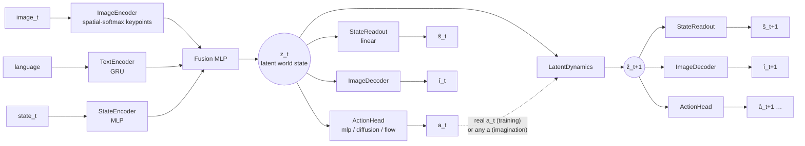
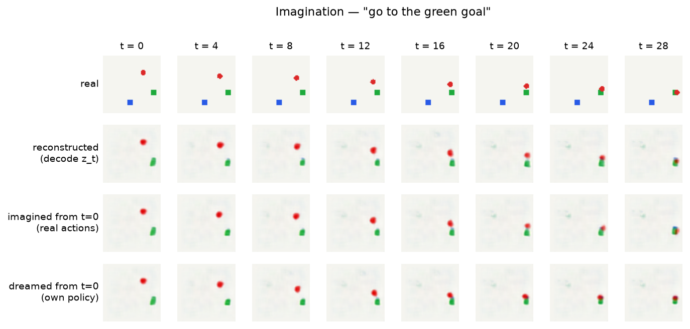
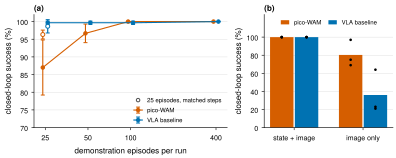
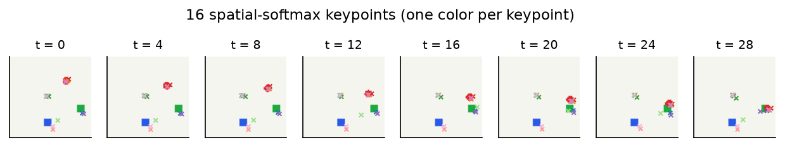
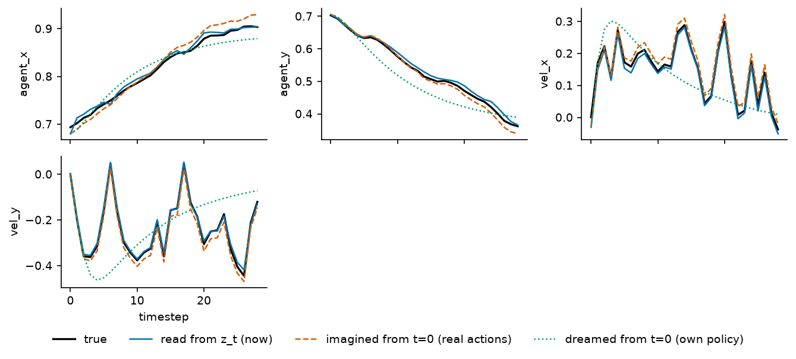
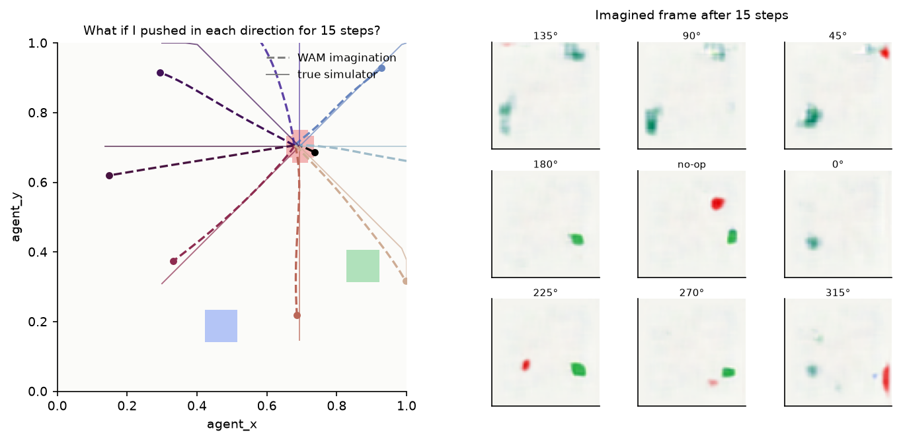
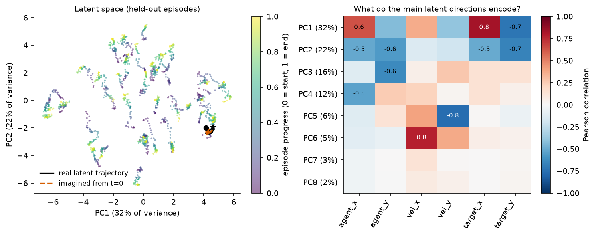
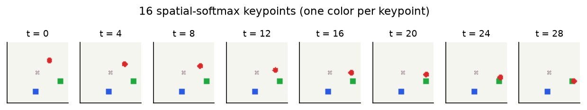

# mini-WAM: Building a World Action Model from Scratch

**Keivalya Pandya**, Northeastern University

*A tutorial written as a research paper. Code: this repository. Companion to [mini-VLA](https://github.com/keivalya/mini-vla).*

---

## Abstract

Vision-Language-Action models (VLAs) map an image, an instruction and the robot state to an action. They learn *what to do*, but nothing in their training asks them *what will happen* when they do it. World Action Models (WAMs) add that second question: the same network that picks the action must also predict the next state of the world.

In this paper I build the smallest WAM I could make that still behaves like one, called **mini-WAM**. It starts from mini-VLA and adds three things: an action-conditioned latent dynamics model, a *linear* readout that turns any latent back into a physical state, and an image decoder that turns it back into a picture. Everything (the policy, the dynamics and the readouts) runs on one shared latent vector, so the model can "imagine" many steps ahead and we can *look at* what it imagines.

I train mini-WAM on a toy 2D world that runs on a laptop, and study it the way you would study a real model: three seeds per experiment, held-out episodes, and a counterfactual test against the true simulator. Four findings stand out. (1) The latent world model imagines 15 steps ahead with about 80× less state error than assuming nothing changes, and every imagined latent is linearly readable. (2) Trained on expert demonstrations alone, it predicts what happened *better* but understands other actions 15× *worse*; a few random-action bursts in the data fix this. (3) The training horizon trades short-range for long-range accuracy, while the latent-consistency and pixel losses matter little here. (4) The world-model objective does not help the policy when the state is given, but when the model must work from pixels alone it more than doubles closed-loop success (80% vs. 36%). The probe shows why: imagination recovers the velocity a single frame cannot show.

All of mini-WAM is about 1,000 lines of PyTorch. The point is not state-of-the-art numbers. The point is that you can read every line, change one thing, and see what the world model learned.

---

## 1. Introduction

If you have trained a VLA, or just read mini-VLA, you know the recipe: encode the image, encode the instruction, encode the robot state, fuse them, and regress (or diffuse) an action.

```text
mini-VLA:   image_t + language + state_t → action_t
```

That recipe works surprisingly well, but it is *reactive*. A recent survey of World Action Models puts it like this:

> "Despite this progress, most VLA policies remain primarily reactive. They are typically trained to map the current observation, a short history, and a task instruction to the next action, without explicitly modeling how alternative actions would change future observations, physical states, or task progress" ([Survey](https://www.alphaxiv.org/abs/2609.16074))

A World Action Model keeps the VLA's job and adds a second one:

```text
mini-WAM:   image_t + language + state_t → action_t + state_t+1 + image_t+1
```

The same survey defines WAMs as "predictive control models that connect future-state modeling with executable action generation" ([Survey](https://www.alphaxiv.org/abs/2609.16074)). Today's WAMs are large: video diffusion backbones, billions of parameters, and robot datasets that most of us cannot train on. That makes it hard to build intuition. What does the "world model" part actually learn? When does it help? What breaks?

This paper is my attempt to answer those questions at a scale where you can watch everything happen. My contributions are:

1. **A minimal WAM** (§3). mini-VLA plus three small modules: latent dynamics, a linear state readout and an image decoder, all on one shared latent. Each new module is under 100 lines.
2. **A toy world built for understanding** (§4). A 2D point mass with momentum and two language-selected goals. It steps and renders in a fraction of a millisecond, and its true state is six numbers, so we can check exactly what the latent encodes.
3. **Tools for looking inside** (§5.6): imagination strips, belief traces, a latent map, "what if" counterfactuals and an error-vs-horizon curve.
4. **A small but careful study** (§5). Three seeds per configuration, held-out episodes, and ablations of the data, the loss terms and the imagination horizon. It also includes the experiment that made me rethink the data: a world model trained only on expert demos *learns to ignore the action*.

> **A note on the name.** While writing this I found an unrelated paper also called *MiniWAM* ([Chen et al., 2026](https://www.alphaxiv.org/abs/2610.12194)). It is a 0.25B-parameter model that predicts compact learned future representations instead of native visual features. This project (mini-WAM, with a hyphen) is an educational from-scratch implementation and is not connected to that work.

---

## 2. Background: from VLAs to WAMs

### 2.1 What you already know, and what it becomes in a WAM

Most of a WAM is made of things you have already met somewhere else in robotics or ML. This table is the map I wish I had when I started:

| If you know… | …then in mini-WAM it is | File |
|---|---|---|
| A VLA's vision/language/state encoders + fusion | the **observation encoder** that produces the latent world state $z_t$ | `models/encoders.py`, `models/fusion.py` |
| A VLA's action head (MLP, diffusion, flow) | the **policy** $\pi(a_t \mid z_t)$, unchanged | `models/action_heads.py` |
| A forward model / simulator $s_{t+1}=f(s_t,a_t)$ from controls | the **latent dynamics** $z_{t+1}=f_\theta(z_t,a_t)$, a simulator learned in latent space | `models/dynamics_head.py` |
| A state estimator / Kalman filter output | the **state readout** $\hat s = W z + b$, which reads the physical state back out of $z$ | `models/dynamics_head.py` |
| An autoencoder's decoder | the **image decoder**, which renders any latent (real or imagined) as a picture | `models/image_decoder.py` |
| Rolling out a model in MPC | **imagination**: apply $f_\theta$ repeatedly with a chosen action sequence | `MiniWAMPolicy.imagine` |
| A linear probe in interpretability ([Alain & Bengio](https://www.alphaxiv.org/abs/1610.01644)) | the readout is *literally* a linear probe, trained jointly | `StateReadout(linear=True)` |

### 2.2 World models

The idea of learning a model of the world and acting inside it is old in control (system identification, MPC) and in RL (model-based RL). Three lines of work shaped mini-WAM:

* **World Models** ([Ha & Schmidhuber](https://www.alphaxiv.org/abs/1809.01999)) and **Dreamer** ([Hafner et al.](https://www.alphaxiv.org/abs/1912.01603)) learn a compact latent state from pixels and a dynamics model on top of it, then learn behaviour "by latent imagination". mini-WAM's `imagine()` is the same idea in its simplest form.
* **TD-MPC2** ([Hansen et al.](https://www.alphaxiv.org/abs/2310.16828)) learns a latent dynamics model for continuous control and plans with it. mini-WAM's *latent consistency* loss (the imagined latent should match the encoding of the real future observation) is in the same spirit.
* **Spatial-softmax keypoints** ([Finn et al.](https://doi.org/10.1109/icra.2016.7487173)) turn conv feature maps into $(x, y)$ coordinates. mini-WAM uses them as its image encoder because global average pooling throws away *where* things are, and a world model needs exactly that.

### 2.3 VLAs

VLAs such as RT-2 ([Brohan et al.](https://doi.org/10.48550/arxiv.2307.15818)), OpenVLA ([Kim et al.](https://www.alphaxiv.org/abs/2406.09246)) and π0 ([Black et al.](https://doi.org/10.15607/rss.2025.xxi.010)) scale the "observation + instruction → action" recipe with large pretrained backbones and large robot datasets. Their action heads (discrete tokens, diffusion ([Chi et al.](https://doi.org/10.15607/rss.2023.xix.026)), flow matching ([Lipman et al.](https://doi.org/10.48550/arxiv.2210.02747))) carry over unchanged to WAMs. mini-VLA and mini-WAM implement all three of MLP, diffusion and flow.

Interestingly, there is evidence that large VLAs may *already* contain some implicit model of state transitions: Molinari et al. probe OpenVLA's internal activations for future state changes ([Emergent World Representations in OpenVLA](https://www.alphaxiv.org/abs/2509.24559)). A WAM makes that model *explicit*, so it can be trained, tested and used directly.

### 2.4 World Action Models

The survey ([Survey](https://www.alphaxiv.org/abs/2609.16074)) separates two families:

* **Joint prediction:** one model predicts future observations *and* actions, so future prediction acts as extra supervision for the policy. Examples include unified video-action models such as UWM ([Zhu et al.](https://doi.org/10.15607/rss.2025.xxi.015)) and video-pretrained policies such as GR-1 ([Wu et al.](https://doi.org/10.48550/arxiv.2312.13139)).
* **Plan-then-act:** first predict the future (often as video), then recover the action with an inverse dynamics model. UniPi ([Du et al.](https://doi.org/10.52202/075280-0403)) is an early example.

mini-WAM is a *joint-prediction* WAM, with a twist: its dynamics model is **action-conditioned**, so it can answer "what if" questions about actions it was not shown. That matters, because predicting what actually happened is not the same as understanding actions. In AD-WM, Qiu et al. write that a model "can therefore achieve low factual prediction error yet poorly distinguish candidate actions" ([AD-WM](https://www.alphaxiv.org/abs/2609.30264)). §5.3 shows exactly this failure in a tiny model.

---

## 3. mini-WAM

### 3.1 Overview



*Figure 1. **mini-WAM: everything on one latent.** The observation encoder (from mini-VLA) produces $z_t$. The policy, the state readout and the image decoder read from $z_t$; the latent dynamics moves it forward given an action. Applying the dynamics repeatedly gives imagined latents, which are read out with the same readout and decoder.*

The whole design rests on one idea: **everything lives on the same latent $z$.** The policy acts from $z$, the dynamics moves $z$ forward given an action, and the readouts turn *any* $z$, encoded from a real frame or imagined, back into a state and an image. Because the policy also reads $z$, the model can roll its own policy forward without ever touching the environment (the "dream" row in Figure 3).

### 3.2 Observation encoder → latent world state

This part is mini-VLA, nearly unchanged (`models/encoders.py`, `models/fusion.py`):

$$z_t = \mathrm{LN}\big(\mathrm{MLP}([\,e_{\text{img}}(o_t);\ e_{\text{txt}}(\ell);\ e_{\text{state}}(\tilde s_t)\,])\big) \in \mathbb{R}^{128}$$

where $\tilde s_t$ is the state normalized with dataset statistics. The one change is the image encoder: a three-layer CNN followed by a **spatial softmax** over 16 heatmaps, giving 16 $(x, y)$ keypoints plus a pooled feature vector. mini-VLA's TinyCNN with global average pooling is still available (`--image_encoder cnn`).

### 3.3 Policy head

The action head maps $z_t$ to $a_t$ and is the same as in mini-VLA: an MLP regressor, a DDPM diffusion head, or a flow-matching head (`models/action_heads.py`). All three expose `loss(actions, z)` and `sample(z)`, so the rest of the model never needs to know which head it is talking to.

> **Bug fix carried back from mini-VLA.** The original diffusion head used a linear noise schedule from $10^{-4}$ to $10^{-2}$ with $T=16$ steps. That ends at $\bar\alpha_T \approx 0.92$, which means the "fully noised" action is still 92% signal. Sampling, though, starts from pure Gaussian noise the model never saw. mini-WAM switches to the cosine schedule of [Nichol & Dhariwal](https://doi.org/10.48550/arxiv.2102.09672) ($\bar\alpha_T \approx 10^{-5}$ at $T=16$) and samples from the proper DDPM posterior.

### 3.4 Latent dynamics: a learned simulator

```python
class LatentDynamicsMLP(nn.Module):
    def forward(self, z, action):
        delta = self.net(torch.cat([z, action], dim=-1))
        return self.ln(z + delta)
```

That is the whole world model (`models/dynamics_head.py`). Two small choices matter:

* **Residual:** most of the world stays the same from one step to the next, so the network only predicts the change.
* **LayerNorm on the output:** the fused latent $z_t$ is also LayerNorm-ed, so imagined latents stay on the same scale as real ones and long rollouts don't drift off.

Imagination is just a loop:

$$\hat z_{t} = z_t,\qquad \hat z_{t+k} = f_\theta(\hat z_{t+k-1},\, a_{t+k-1}),\quad k=1,\dots,H.$$

### 3.5 Readouts: making the latent readable

* **State readout** (`StateReadout`): by default a single linear layer, $\hat s = W z + b$. If agent position and velocity can be recovered *linearly* from $z$, they are explicitly encoded there, and the rows of $W$ tell you which latent directions mean what. This is a linear probe ([Alain & Bengio](https://www.alphaxiv.org/abs/1610.01644)), trained jointly with everything else and applied to real *and* imagined latents.
* **Image decoder** (`models/image_decoder.py`): $z \to 128\times4\times4 \to$ four (upsample + conv) blocks $\to 3\times64\times64$. It predicts the *difference from the dataset's mean image*, with no sigmoid. Most pixels are static background, so the decoder starts out already drawing the background. A sigmoid output saturates, and in my first version that stalled learning completely.

### 3.6 Training objective

Each training sample is a window of $H$ steps inside one episode: $o_t, a_t, \dots, a_{t+H-1}, o_{t+1}, \dots, o_{t+H}$. With $z_t = \mathrm{enc}(o_t)$ and the imagined $\hat z_{t+k}$ from §3.4:

$$
\mathcal{L} =
\underbrace{\mathcal{L}_{\text{act}}(a_t \mid z_t)}_{\text{imitate (expert steps only)}}
+ w_s\Big(\underbrace{\|R(z_t)-\tilde s_t\|^2}_{\text{know the state now}} + \underbrace{\tfrac1H\textstyle\sum_k\|R(\hat z_{t+k})-\tilde s_{t+k}\|^2}_{\text{predict it}}\Big)
+ w_i\Big(\|D(z_t)-o_t\|^2 + \tfrac1H\textstyle\sum_k\|D(\hat z_{t+k})-o_{t+k}\|^2\Big)
+ w_z\,\tfrac1H\textstyle\sum_k\big\|\hat z_{t+k}-\mathrm{sg}[\mathrm{enc}(o_{t+k})]\big\|^2
$$

with $R$ the state readout, $D$ the image decoder, $\mathrm{sg}$ stop-gradient, and defaults $w_s=0.5$, $w_i=1$, $w_z=1$, $H=5$ (`models/losses.py`).

* The **reconstruction** terms anchor $z_t$ to the real world and stop the latent from collapsing to a constant.
* The **prediction** terms teach the dynamics what actions do.
* The **latent consistency** term keeps imagined latents *in distribution*, so the policy and decoders still make sense when applied to them.

Setting `--model_type vla` removes everything except $\mathcal{L}_{\text{act}}$ and gives back mini-VLA with identical encoders. That is the baseline in every experiment.

### 3.7 How big is it?

Parameter counts for the toy world (state dim 6, action dim 2, $d=128$, MLP head):

| module | file | lines | parameters |
|---|---|---|---|
| image encoder (keypoints) | `models/encoders.py` | 123 (all encoders) | 71,568 |
| text encoder (GRU) | | | 75,264 |
| state encoder | | | 9,024 |
| fusion | `models/fusion.py` | 20 | 66,048 |
| action head (MLP) | `models/action_heads.py` | 55 | 16,770 |
| **latent dynamics** | `models/dynamics_head.py` | 89 | **132,480** |
| **state readout (linear)** | | | **774** |
| **image decoder** | `models/image_decoder.py` | 59 | **375,811** |
| losses | `models/losses.py` | 76 | — |
| wiring + `imagine()` | `models/wam_policy.py` | 258 | — |
| **total** | | | **WAM 747,739 · VLA 238,674** |

The bold rows are what a WAM adds to a VLA. Two-thirds of the extra parameters are the image decoder; the world model itself (dynamics + readout) is about 133k parameters.

---

## 4. A toy world for understanding WAMs

### 4.1 Why not start with Meta-World?

mini-WAM runs on Meta-World too (`--env metaworld`), but for *understanding* a world model I wanted three things Meta-World doesn't give cheaply:

1. **Fast:** 400 episodes are collected in a few seconds on a laptop CPU.
2. **Fully known state:** so "does the latent encode the world?" has a precise answer.
3. **A true simulator for counterfactuals:** so we can ask the model "what if I had pushed left?" and check the answer.

### 4.2 The world

`envs/toy_point_env.py` is a red point mass in the unit square, with a blue and a green goal. The instruction, `"go to the blue goal"` or `"go to the green goal"`, says which goal counts, so the policy has to read the language. The dynamics have momentum:

$$v_{t+1} = 0.8\,v_t + 0.01\,a_t,\qquad p_{t+1} = \mathrm{clip}(p_t + v_{t+1},\,0,\,1),$$

and an episode succeeds when the agent is within 0.05 of the instructed goal **and** almost stopped, so the expert (a PD controller) has to brake. The state is $[\,x, y, v_x, v_y, g_x, g_y\,]$, where $g$ is the *instructed* goal; the other goal appears only in the image. Velocity is not visible in a single frame, so predicting the next frame requires inferring it.

### 4.3 Data: expert demos *plus* exploration

`scripts/collect_data.py` runs the expert, and at each step starts, with probability $p$ (default 0.3), a burst of 1–3 uniformly random actions. Each transition is tagged `is_expert`. **The policy imitates only expert steps; the world model trains on all of them.**

Why bother? In pure expert data, $a_t$ is a function of $s_t$. A world model can then predict $s_{t+1}$ from $s_t$ alone and never look at the action. This is the world-model version of *causal confusion* in imitation learning ([de Haan et al.](https://doi.org/10.48550/arxiv.1905.11979)): a shortcut that fits the data perfectly and fails as soon as you ask about an action the expert didn't take. §5.3 measures it.

---

## 5. Experiments

### 5.1 Setup and metrics

Every configuration is run **three times** (seeds 0, 1, 2). Each seed has its own dataset (400 episodes), its own train/held-out split (360/40 episodes) and its own initialization. Every run trains a mini-WAM *and* a mini-VLA on the same data with the same encoders and MLP action head, for 15 epochs. I report mean ± standard deviation over the three seeds. All runs were done on single GPUs (mostly V100s) on Northeastern's Explorer cluster; one full three-seed run takes about 15 minutes.

What I measure, all on held-out episodes:

| metric | question it answers | reference point |
|---|---|---|
| **closed-loop success** | Does the policy solve the task? 100 episodes per seed, on environment seeds never seen in training. | WAM vs. VLA |
| **imagined state error** at $k$ steps | Encode $o_t$ once, roll the dynamics forward $k$ steps with the actions that were really taken, read out the state, and compare it with the true $s_{t+k}$ (MSE in normalized units). | the **"nothing changes"** baseline $\hat s_{t+k}=s_t$ |
| **counterfactual error** at $k$ steps | Same, but with *random* action sequences the expert never took, compared against the toy simulator's ground truth. | the **"ignore the actions"** baseline: the true future under zero actions |
| **image error** | Pixel MSE between the decoded imagined frame and the real future frame. | copying the current frame |
| **readout $R^2$** | How much of each state variable a *linear* map recovers from real ($k=0$) and imagined ($k>0$) latents. | 1 = perfect |

The two state errors are the heart of the evaluation. The factual one asks *"can you predict what happened?"*; the counterfactual one asks *"do you know what your actions do?"*. As §5.3 shows, a model can ace the first and fail the second.

### 5.2 Does mini-WAM imagine the future?

Yes, at the level of the state, and no, at the level of pixels.


*Figure 2. **mini-WAM's imagined states are accurate and action-aware; its imagined pixels are not.** (a) Imagined state error with the real actions vs. the "nothing changes" baseline. (b) Counterfactual error under random action sequences vs. a model that ignores actions. (c) Pixel error of decoded imagined frames vs. copying the current frame. Mean ± std over 3 seeds (bands are narrow); 40 held-out episodes per seed.*

* **States.** Fifteen steps into an open-loop imagination, the state error is $0.0071 \pm 0.0004$, about 80× lower than the "nothing changes" baseline ($0.582 \pm 0.015$). A linear readout recovers every state variable from the imagined latent with $R^2 \ge 0.977$ (mean $0.992 \pm 0.001$) at $k=15$.
* **Actions.** Under random action sequences the expert never produced, the error after 10 steps is $0.0072 \pm 0.0005$, versus $0.388 \pm 0.001$ for a model that ignored the actions. So the world model has learned what actions *do*, not just what the expert usually did.
* **Pixels.** The decoded imagination is *worse* than just copying the current frame at every horizon ($0.0073$ vs. $0.0050$ at $k=15$). Figure 3 shows why: the decoder draws the agent and the instructed goal, but drops the distractor goal. I come back to this in §6.
* **The policy.** Both mini-WAM and mini-VLA succeed on 100% of test episodes in all three seeds (26.4 vs. 26.1 steps on average). This task is too easy to separate them; §5.5 makes it harder.



*Figure 3. **One held-out episode, as the model sees it.** Row 1: real frames. Row 2: decoding the latent of each real frame. Row 3: decoding an open-loop imagination from $t=0$ with the real actions. The model never sees frames 1–28. Row 4: "dreaming", where the model's own policy picks the actions inside its imagination. Seed 0.*

### 5.3 Does the world model understand actions? (exploration data)

This is the experiment that taught me the most. I trained three world models that differ *only* in the data: 0%, 30% or 60% of steps start a short burst of random actions. Everything else, including the number of episodes, is the same.


*Figure 4. **Trained on expert demos alone, the world model is great at predicting what happened and poor at predicting anything else.** (a) Imagined state error after 10 steps with the real actions (factual, green) and with random actions compared to the true simulator (counterfactual, orange). Grey: the error of a model that ignores the actions altogether. (b) Closed-loop success. Mean ± std over 3 seeds.*

With expert-only data the factual error is the *lowest* of the three settings ($0.0047 \pm 0.0025$ at $k=15$, vs. $0.0071 \pm 0.0004$ with 30% exploration). If factual prediction were all you checked, you would conclude expert-only data is best. The counterfactual error says otherwise: $0.112 \pm 0.005$ at $k=10$, **15× worse** than with exploration ($0.0072 \pm 0.0005$). It is still better than ignoring actions entirely (0.295), so the model uses the action a little, but mostly it has learned *"the expert will drive toward the goal"*.

Why? In expert data the action is a deterministic-ish function of the state, $a_t \approx \pi^*(s_t)$, so

$$s_{t+1} = f(s_t, a_t) \approx f(s_t, \pi^*(s_t)) =: g(s_t).$$

The network can fit $g$ without ever using its action input. Nothing in the loss tells it that $a_t$ matters, because $a_t$ carries no information beyond $s_t$. Imitation learning has the same disease under the name *causal confusion* ([de Haan et al.](https://doi.org/10.48550/arxiv.1905.11979)). The fix is the same too: break the correlation by putting actions into the data that the expert would not have chosen. A few random bursts are enough. Going from 30% to 60% exploration changes little ($0.0063 \pm 0.0023$).

Two lessons I'd carry to big WAMs:

1. **Measure counterfactuals, not just reconstruction.** Video-prediction quality on held-out demos is a factual metric. It can look great while the model ignores the action. AD-WM makes the same point for planning ([AD-WM](https://www.alphaxiv.org/abs/2609.30264)).
2. **The policy does not care, yet.** All three settings reach 100% success, and the policy only imitates expert steps, so exploration data cost nothing here. The world model needs action diversity; the policy needs expert quality. Tagging transitions (`is_expert`) lets one dataset serve both.

### 5.4 Which parts of the objective matter?

Next I removed one piece of the objective at a time, and changed the length $H$ of the imagined windows used in training.


*Figure 5. **The training horizon matters most; the latent-consistency and image losses matter little on this task.** Each row changes one thing relative to the full objective (grey). (a) Imagined state error after 15 steps. (b) Counterfactual error after 10 random-action steps. (c) Closed-loop success. (d) Image error after 1 step. For "no image loss" the decoder is untrained, so (d) is meaningless there. Mean ± std over 3 seeds.*

* **Imagination horizon is the big knob.** Training on one-step transitions ($H=1$) gives the same one-step accuracy as $H=5$ ($0.0019$ in both cases), but the errors compound: after 10 counterfactual steps the error doubles ($0.0139 \pm 0.0008$ vs. $0.0072 \pm 0.0005$). Training on longer windows ($H=10$) goes the other way. Long-range imagination improves ($0.0057 \pm 0.0005$ at $k=10$; $0.0046 \pm 0.0007$ state error at $k=15$), and short-range gets a bit worse ($0.0030 \pm 0.0003$ at $k=1$). *You get good at the horizon you train on.* This is the same trade-off as single-step vs. multi-step ("rollout") losses in model-based RL.
* **The latent-consistency loss buys stability, not accuracy.** Without it, short imaginations are slightly *better* ($0.0016$ vs. $0.0019$ at $k=1$), but 15-step imaginations are worse and much less consistent across seeds ($0.0096 \pm 0.0024$ vs. $0.0071 \pm 0.0004$).
* **The image loss is not what makes the latent good here.** Removing it leaves every state metric within noise ($0.0074 \pm 0.0021$ vs. $0.0071 \pm 0.0004$ at $k=15$). That is not a general statement about pixels: in this task the state is an input, so the latent can learn the world from the state alone. §5.5 removes that crutch.
* **None of it changes the policy.** All variants reach 99–100% closed-loop success.

### 5.5 When does a world model help the policy?

Up to now the policy never benefited: mini-VLA was already at 100%. I tried two ways of making the task harder for the *policy*: fewer demonstrations, and taking away the state input.



*Figure 10. **The world-model objective hurts with very few demos, and helps a lot when the state must be inferred from pixels.** (a) Closed-loop success vs. number of demonstration episodes (15 epochs each). Open markers: the same 25 episodes trained ~15× longer, to match the baseline's number of gradient steps. (b) Success with and without the state input (400 episodes). Mean ± std over 3 seeds; 100 test episodes per seed.*

**Few demonstrations: the WAM is *worse*.** With 25 episodes per seed, mini-WAM succeeds $87.0 \pm 7.8\%$ of the time vs. $99.7 \pm 0.5\%$ for mini-VLA. With 50 episodes the gap shrinks ($96.7 \pm 2.6\%$ vs. $99.7 \pm 0.5\%$), and with 100 it is gone ($100\%$ vs. $99.7 \pm 0.5\%$). One confound is training length. All runs use 15 epochs, so 25 episodes means about 1/16 of the baseline's gradient steps, and the WAM has more to learn in those steps. To check, I trained the same 25-episode datasets for 225 epochs, roughly the baseline's number of gradient steps. The gap mostly closes: $96.3 \pm 1.2\%$ for mini-WAM vs. $98.7 \pm 1.9\%$ for mini-VLA. So most of the low-data penalty was *undertraining*: the WAM has four losses to fit and needs more steps to get its policy right. What remains is small, and within about one standard deviation. Training longer does expose a new problem, though. The world model overfits 22 training episodes badly (image loss 0.0005 on training data vs. 0.016 on held-out episodes; imagined-state $R^2$ at $k=15$ only $0.72 \pm 0.17$). A world model needs far more data than a policy to be good.

**No state input: the WAM is much *better*.** When both models see only the image and the instruction, mini-WAM succeeds $80.3 \pm 12.0\%$ of the time and mini-VLA only $36.0 \pm 19.8\%$ (mean episode length 32.5 vs. 60.1 steps). The spread across seeds is large, but the WAM is ahead in every seed (WAM/VLA success: 97/23, 69/64 and 75/21%).

Why does the world model help so much here? The probe gives a clean answer. Velocity is invisible in a single frame, and it matters: the agent has momentum, and the expert brakes before the goal. Look at the linear readout of mini-WAM's latent:

| readout $R^2$ | position $(x, y)$ | velocity $(v_x, v_y)$ |
|---|---|---|
| encoded current frame ($k=0$) | 0.994 / 0.993 | **0.47 / 0.50** |
| after 1 imagined step | 0.994 / 0.992 | 0.69 / 0.71 |
| after 5 imagined steps | 0.985 / 0.981 | **0.92 / 0.93** |

*(Image-only run, mean of 3 seeds; full numbers in `docs/results/image-only`.)*

From pixels alone, the latent knows *where* the agent is but only about half of *how fast* it is going. After a few imagined steps it knows velocity well, because the dynamics model integrates the actions it was given. If you have built a Kalman filter, this is the *predict* step: a motion model plus known controls recovers a state you cannot observe directly. The WAM is forced to learn that motion model; the VLA is not.

The keypoints tell the same story (Figure 11). Without the state input, the spatial-softmax keypoints that had collapsed to the image center in the baseline (Figure 9) now lock onto the agent and the goals.



*Figure 11. **Without the state input, the encoder learns to look.** Several keypoints follow the red agent; others sit on the goals. Seed 0 of the image-only run.*

One caveat: mini-WAM's *policy* still acts on the encoding of the current frame. It never uses the imagined velocity at test time. So the benefit comes from training: predicting the future forces the shared encoder to represent things, like motion cues, that help the policy as well. A policy that consumes the imagination directly, or a short history of frames, would probably do better still. I have not tested either.

### 5.6 Looking inside the world model

The numbers above say the latent world model works. The figures in this section show *what it believes*. All are produced by `scripts/visualize_rollout.py` for seed 0 of the baseline.

**Beliefs over time.** Figure 6 plots each state variable for one held-out episode: the truth, what the latent says *now* (read out from the encoding of each real frame), what the model *imagined* from $t=0$ with the real actions, and what it *dreamed* with its own policy. The imagined velocity follows every wiggle of the (noisy) expert for 28 steps without seeing a single new frame. The dream is smooth, because the learned policy is deterministic and has no expert noise, but it still ends up at the goal.



*Figure 6. **The imagined trajectory tracks the true one, wiggles and all.** Black: truth. Blue: linear readout of the real latent at each step. Orange dashed: open-loop imagination from $t=0$ using the real actions. Green dotted: the model's own policy acting inside its imagination. Seed 0, one held-out episode.*

**What if?** Figure 7 starts from one real frame and asks the model to imagine 15 steps of a constant push in nine directions. Solid lines are the true simulator. Most imagined trajectories land close to the truth, but several (pushing right, up and down) stop short or bend. A constant push for 15 steps is much longer than any random burst in the training data (at most 3 steps), so this is a test of extrapolation, and the model is visibly less sure there. The decoded frames on the right are rougher still: the agent is often missing. The *state* of the imagination is better than its *picture*.



*Figure 7. **Counterfactual imagination: same start, nine different pushes.** Left: imagined (dashed) vs. true (solid) agent trajectories for 15 steps of constant force. Right: decoded imagined frames after 15 steps. Seed 0.*

**The latent map.** Figure 8 projects held-out latents onto their top principal components. The first two components mostly encode *where the goal is* (each streak is roughly one episode), and the velocity components only appear at PC5–PC6. That is a useful reminder that PCA ranks directions by *variance*, not importance: the latent spends most of its variance on the goal location because that varies most across episodes.



*Figure 8. **The latent is organized by goal location first, velocity later.** Left: PCA of held-out latents, colored by episode progress, with one real (black) and imagined (orange) trajectory. Right: correlation of each principal component with each state variable. Seed 0.*

**What does the image encoder look at? Nothing, apparently.** Figure 9 draws the 16 spatial-softmax keypoints. They all sit at the image center, which means the heatmaps are nearly flat. My interpretation: the state input already tells the model where the agent and goal are, so the image encoder has no pressure to localize anything. The image-only experiment in §5.5 tests this.



*Figure 9. **With the state as input, the keypoint encoder learns nothing spatial.** The 16 keypoints collapse to the image center. Seed 0 of the baseline.*

## 6. Discussion and lessons

Here is what I would tell someone moving from VLAs to WAMs, based on what this small model did.

**1. A WAM is a VLA with a learned simulator attached, and the simulator can be very good.** mini-WAM's latent dynamics is a 132k-parameter residual MLP. On held-out episodes it imagines 15 steps ahead with about 80× less error than assuming nothing changes, and a single linear layer reads position, velocity and goal out of every imagined latent. If you have used a forward model in MPC, this is the same object, learned from pixels + language + state instead of written down.

**2. "Predicts the future well" and "understands actions" are different claims. Test both.** The expert-only world model had the *best* factual imagination and the *worst* counterfactual one (§5.3). Any metric computed on held-out *demonstrations* (reconstruction, video quality, next-state MSE) is factual. To know whether the model would be useful for choosing *between* actions, you need counterfactual data or a simulator to check against. This connects to a broader point in the literature: "a model can therefore achieve low factual prediction error yet poorly distinguish candidate actions" ([AD-WM](https://www.alphaxiv.org/abs/2609.30264)).

**3. The world model needs different data than the policy.** The policy wants expert actions; the world model wants *varied* actions. Mixing a few random bursts into the demos and tagging them (`is_expert`) served both at no cost to the policy. For real robots, the same role could be played by play data, failed attempts, or autonomous rollouts, which are data a pure imitation learner would throw away.

**4. You get good at the horizon you train on.** One-step training compounds errors; ten-step training trades a bit of one-step accuracy for much better long rollouts (§5.4). If you plan to imagine $k$ steps ahead, train on windows of about $k$ steps.

**5. Pixels are an expensive and misleading target.** mini-WAM's decoded imagination was worse than copying the frame, mostly because it drops the distractor goal, an object that is irrelevant to the instructed task. Meanwhile the *state* of the imagination was excellent. Large WAMs face the same tension at scale. Chen et al.'s MiniWAM, for example, predicts compact learned future representations instead of native visual features and reports that this is both cheaper and better for policy learning ([MiniWAM](https://www.alphaxiv.org/abs/2610.12194)). The survey puts the general point well: "This separation can create a mismatch between predictive fidelity and control utility: visually plausible futures are not necessarily actionable, and accurate short-horizon prediction does not guarantee robust long-horizon behavior" ([Survey](https://www.alphaxiv.org/abs/2609.16074)).

**6. A world-model objective does not automatically make a better policy, but it helps when the policy has to infer something.** When the state was given, the WAM's policy was never better than the VLA's. With very few demos it was worse, mostly because it needed more training steps (§5.5). When the state had to be inferred from pixels, the WAM more than doubled the success rate ($80\%$ vs. $36\%$), and the probe shows why: learning to predict the future forces the latent to model motion, which a single frame does not show. My takeaway is that world modeling pays off when there is *hidden state* the future depends on. That describes most real robot problems (occlusion, contact forces, object properties), and it describes very little of a fully observed toy world.

### Limitations

* **Toy world, one task family.** Everything here is a 2D point mass with two goals. The dynamics are smooth and fully observed when the state is an input. Contact, occlusion and long horizons are where WAMs are supposed to shine, and none of them are present.
* **The world model is never *used* at test time.** mini-WAM's policy acts reactively from $z_t$, exactly like a VLA. The world model shapes the latent during training, and `imagine()` is used for analysis, but there is no planning. Using the imagination to choose actions (MPC, or training the policy inside the dream as Dreamer does) is the obvious next step.
* **Small study.** Three seeds per configuration, one set of hyperparameters (tuned for the baseline), 15 epochs, MLP action head only.
* **The counterfactual test only checks agent position and velocity**, and only in the toy world, where a true simulator exists.

### What I'd try next

1. **Plan with the world model.** Sample action sequences, imagine each with `model.imagine(..., actions=...)`, score the imagined states against the goal, and execute the best first action. Everything needed is already in the code.
2. **Make the task need foresight:** obstacles, a goal that moves, or delayed effects.
3. **Meta-World.** `collect_data.py` and `test.py` already support it.


## 7. Conclusion

A World Action Model is not a mysterious new kind of network. It is a VLA plus a learned simulator that shares the VLA's latent space. mini-WAM builds one in about 1,000 lines. The simulator works: it imagines accurately, it can be read linearly, and it responds to actions, *if* the data contains actions worth responding to. The study also shows the two places where WAMs differ most from VLAs in practice. They need different data (diverse actions, not just expert ones), and they pay off most when something about the world is hidden from a single observation. Both lessons were cheap to find at this scale, and I expect both to matter at every scale.

## 8. Reproducing everything

```sh
pip install -r requirements.txt
bash scripts/run_toy.sh        # 3 seeds: collect, train WAM + VLA, evaluate, test, visualize, summarize
```

Every experiment in §5 is `scripts/run_toy.sh` with **one line** of its configuration block changed:

| experiment | change in `scripts/run_toy.sh` | results |
|---|---|---|
| baseline | none | `docs/results/baseline` |
| expert-only data | `RANDOM_ACTION_PROB=0.0` | `docs/results/explore-0.0` |
| more exploration | `RANDOM_ACTION_PROB=0.6` | `docs/results/explore-0.6` |
| no latent-consistency loss | `LATENT_WEIGHT=0.0` | `docs/results/no-latent` |
| no image loss | `IMAGE_WEIGHT=0.0` | `docs/results/no-image` |
| horizon 1 / 10 | `HORIZON=1` / `HORIZON=10` | `docs/results/horizon-1`, `horizon-10` |
| fewer demos | `EPISODES=25` / `50` / `100` | `docs/results/episodes-*` |
| 25 demos, matched steps | `EPISODES=25`, `EPOCHS=225` | `docs/results/episodes-25-matched` |
| image + language only | `STATE_INPUT=0` | `docs/results/image-only` |

Each results folder has, per seed, `wam_eval.json` (imagination and counterfactual errors, readout $R^2$), `wam_test.json` and `vla_test.json` (closed-loop success), plus a `summary.json` with mean ± std. The figures are rebuilt from those files with `python docs/figures/make_figures.py`.

On a single V100, one three-seed run takes about 15–30 minutes.

## References

1. Alain, G. & Bengio, Y. *Understanding intermediate layers using linear classifier probes.* [alphaXiv](https://www.alphaxiv.org/abs/1610.01644)
2. Black, K. et al. *π0: A Vision-Language-Action Flow Model for General Robot Control.* RSS 2025. [doi](https://doi.org/10.15607/rss.2025.xxi.010)
3. Brohan, A. et al. *RT-2: Vision-Language-Action Models Transfer Web Knowledge to Robotic Control.* 2023. [doi](https://doi.org/10.48550/arxiv.2307.15818)
4. Chen, J. et al. *MiniWAM: Learning Compact Future Targets for Efficient World-Action Modeling.* 2026. [alphaXiv](https://www.alphaxiv.org/abs/2610.12194)
5. Chi, C. et al. *Diffusion Policy: Visuomotor Policy Learning via Action Diffusion.* RSS 2023. [doi](https://doi.org/10.15607/rss.2023.xix.026)
6. de Haan, P., Jayaraman, D. & Levine, S. *Causal Confusion in Imitation Learning.* 2019. [doi](https://doi.org/10.48550/arxiv.1905.11979)
7. Du, Y. et al. *Learning Universal Policies via Text-Guided Video Generation.* 2023. [doi](https://doi.org/10.52202/075280-0403)
8. Finn, C. et al. *Deep Spatial Autoencoders for Visuomotor Learning.* ICRA 2016. [doi](https://doi.org/10.1109/icra.2016.7487173)
9. Ha, D. & Schmidhuber, J. *Recurrent World Models Facilitate Policy Evolution.* 2018. [alphaXiv](https://www.alphaxiv.org/abs/1809.01999)
10. Hafner, D. et al. *Dream to Control: Learning Behaviors by Latent Imagination.* 2019. [alphaXiv](https://www.alphaxiv.org/abs/1912.01603)
11. Hansen, N., Su, H. & Wang, X. *TD-MPC2: Scalable, Robust World Models for Continuous Control.* 2023. [alphaXiv](https://www.alphaxiv.org/abs/2310.16828)
12. Kim, M. J. et al. *OpenVLA: An Open-Source Vision-Language-Action Model.* 2024. [alphaXiv](https://www.alphaxiv.org/abs/2406.09246)
13. Lipman, Y. et al. *Flow Matching for Generative Modeling.* 2022. [doi](https://doi.org/10.48550/arxiv.2210.02747)
14. Lu, Z., Zhai, H. et al. *World-Action Models for Robot Learning and Control: A Survey.* 2026. [alphaXiv](https://www.alphaxiv.org/abs/2609.16074)
15. Molinari, M. et al. *Emergent World Representations in OpenVLA.* 2025. [alphaXiv](https://www.alphaxiv.org/abs/2509.24559)
16. Nichol, A. & Dhariwal, P. *Improved Denoising Diffusion Probabilistic Models.* 2021. [doi](https://doi.org/10.48550/arxiv.2102.09672)
17. Qiu, J., Chen, Z. et al. *AD-WM: Action-Discriminative World Models for Counterfactual Model Predictive Control.* 2026. [alphaXiv](https://www.alphaxiv.org/abs/2609.30264)
18. Wu, H. et al. *Unleashing Large-Scale Video Generative Pre-training for Visual Robot Manipulation* (GR-1). 2023. [doi](https://doi.org/10.48550/arxiv.2312.13139)
19. Zhu, C. et al. *Unified World Models: Coupling Video and Action Diffusion for Pretraining on Large Robotic Datasets.* RSS 2025. [doi](https://doi.org/10.15607/rss.2025.xxi.015)
