# Building a World Action Model from Scratch

### A hands-on tutorial with picoWAM

**Keivalya Pandya**, Northeastern University

*This is the long, friendly version of the [picoWAM paper (PDF)](paper/pico-wam-paper.pdf). Same experiments, same numbers, a lot more explanation. Code: this repository.*

---

## How to read this

I wrote this for three kinds of readers, and you can skip around:

| If you are… | Start at | You can skip |
|---|---|---|
| **new to robot learning** | [Part 0](#part-0--five-ideas-you-need) (five ideas in plain words) | nothing, read it in order |
| **comfortable with VLAs / imitation learning** | [Part 1](#part-1--vla-world-model-wam) | Part 0 |
| **a researcher who wants the results** | [Part 5](#part-5--what-worked-and-what-did-not) and [Part 6](#part-6--where-the-cost-goes) | most of Parts 0–3 |

> **TL;DR.** A World Action Model (WAM) is a robot policy that also learns to predict what its actions will do. I built a tiny one, **picoWAM** (0.75M parameters, ~1,000 lines of PyTorch), trained it on a toy world where I know the true physics, and poked at it until it told me something. Three things stuck with me:
> 1. **A world model trained only on expert demos looks great and understands actions badly.** Its predictions of what *did* happen are excellent, but its predictions of what *would* happen under other actions are 15× worse. A few random actions in the data fix it.
> 2. **Predicting the future helps the policy only when the observation hides something.** With the robot state as input: no gain. With pixels only: success jumps from 36% to 80%. A follow-up experiment says most of that comes from teaching the network the *current* state, not from predicting the future.
> 3. **Pixels are where the cost is.** The image decoder holds half the parameters and ~90% of the training compute.

---

## Part 0 — Five ideas you need

If you already train robot policies, skip this. If not, these five ideas are all you need for the rest of the tutorial.

**1. A policy** is a function that picks an action. You give it what the robot sees (a camera image), what it knows about itself (its joint angles or position, the *state*), and what you want (an instruction like "go to the blue goal"). It gives back an action, like "push a little to the right".

**2. Imitation learning (behavioral cloning, BC)** is the simplest way to train a policy: record an expert doing the task, then train the network to copy the expert's action in every situation. It is plain supervised learning, inputs to labels. A **VLA** (vision-language-action model) is a policy trained this way that takes images and language as input.

**3. A world model** (or *forward model*) answers a different question: *if I am here and I do this, where will I be next?* Engineers have written these by hand for decades. That's what a physics simulator is, and what model-predictive control (MPC) uses to plan. A *learned* world model learns this from data instead.

**4. A latent** is a compact vector the network uses internally to summarize what it sees. In picoWAM it is 128 numbers, called $z_t$. You can't read it directly, but you can train small "readout" networks to turn it back into things you understand (positions, velocities, pictures).

**5. Imagination (a rollout)** means applying the world model again and again without looking at the real world: from $z_t$ and an action, predict $z_{t+1}$; from that and the next action, predict $z_{t+2}$; and so on. If the predictions stay good for many steps, the model has learned something real about the world.

That's it. A **WAM** combines idea 1 and idea 3 in one network.

---

## Part 1 — VLA, world model, WAM

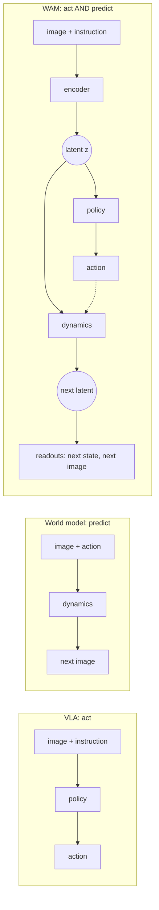

*Figure 1. A VLA acts, a world model predicts, a WAM does both with a shared latent. The dashed arrow is the key: the dynamics can be fed **any** action, the policy's own or one you make up, so you can ask the model "what would happen if…?".*

A recent survey defines WAMs as models that "connect future-state modeling with executable action generation" ([Lu et al.](https://www.alphaxiv.org/abs/2609.16074)). Another sorts them by the future they produce: pixels, a latent, or nothing at all ([Shen et al.](https://www.alphaxiv.org/abs/2606.20781)).

Here's the map I wish someone had handed me when I moved from VLAs to WAMs. Almost every part of a WAM is something you've met before under a different name:

| If you know… | …in picoWAM it is | File |
|---|---|---|
| a VLA's vision / language / state encoders | the **observation encoder** that produces the latent $z_t$ | `models/encoders.py`, `models/fusion.py` |
| a VLA's action head (MLP, diffusion, flow) | the **policy** $\pi(a_t \mid z_t)$, unchanged | `models/action_heads.py` |
| a simulator / forward model in MPC | the **latent dynamics** $z_{t+1} = f_\theta(z_t, a_t)$ | `models/dynamics_head.py` |
| a state estimator | the **linear state readout** $\hat s = Wz + b$ | `models/dynamics_head.py` |
| an autoencoder's decoder | the **image decoder**, which draws any latent | `models/image_decoder.py` |
| rolling out a model in MPC | **imagination**: apply $f_\theta$ repeatedly | `PicoWAMPolicy.imagine` |
| a linear probe in interpretability | the readout, literally a linear probe trained jointly | `StateReadout` |

> **A note on the name.** This project started life as *mini-WAM*, the world-model sequel to my [mini-VLA](https://github.com/keivalya/mini-vla). I renamed it **picoWAM** because an unrelated 2026 paper is called *MiniWAM* ([Chen et al.](https://www.alphaxiv.org/abs/2610.12194)), a 0.25B-parameter model that predicts compact learned future targets. Different project, different goals; the new name just keeps them apart.

---

## Part 2 — The WAM design space, and the WAMs you can download today

Every WAM, from my 0.75M-parameter toy to a 5B-parameter video model, makes the same four decisions:

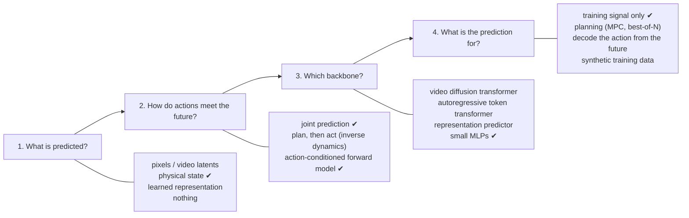

*Figure 2. The four decisions. Ticks (✔) mark picoWAM's choices.*

Let me walk through each decision in plain words.

1. **What is predicted?** You can predict raw future frames (expensive, but you can look at them), a compressed learned representation (cheap, but harder to inspect), the physical state (only possible when you know it, as in simulation), or nothing at all. picoWAM predicts the physical state, and pixels as an option.
2. **How do actions meet the future?** You can generate the action and the future together ("joint prediction"). You can generate the future first, then ask an *inverse dynamics* model which action gets you there ("plan, then act"). Or you can build an explicit forward model that takes *any* action as input. picoWAM trains jointly *and* has an explicit action-conditioned forward model, which is what makes "what if" questions possible.
3. **Which backbone?** Big systems reuse pretrained video-generation models. I use small MLPs so everything trains on a laptop.
4. **What is the prediction for?** It can just shape the representation during training (the cheapest option and the most common), rank candidate actions at test time (planning), produce the action directly, or generate fake training data for another policy.

### A tour of eight open-source WAMs

Here are eight WAMs whose code you can download today. They span the whole design space:

- **GR-1** ([Wu et al.](https://www.alphaxiv.org/abs/2312.13139)) is a GPT-style transformer, pretrained to predict future frames from Ego4D human videos, then fine-tuned to output actions *and* future images. The future prediction is an auxiliary training signal.
- **UWM** ([Zhu et al.](https://doi.org/10.15607/rss.2025.xxi.015)) puts video diffusion and action diffusion into one transformer, with a separate noise level for each. By choosing which one to denoise, the same network acts as a policy, a forward model, an inverse model or a video generator. That trick also lets it learn from videos that have no action labels.
- **WorldVLA** ([Cen et al.](https://www.alphaxiv.org/abs/2506.21539)) turns images, text and actions into discrete tokens in one autoregressive multimodal LLM, which learns both to output action tokens and to predict the next frame.
- **Genie Envisioner** ([Liao et al.](https://www.alphaxiv.org/abs/2508.05635)) is a 2B-parameter video diffusion transformer pretrained on about a million real robot episodes, with a lightweight flow-matching action module that reads its video latents. The video model doubles as a neural simulator.
- **Cosmos Policy** ([Kim et al.](https://www.alphaxiv.org/abs/2601.16163)) fine-tunes NVIDIA's 2B Cosmos-Predict2 video model *without changing its architecture*: actions, robot state and value estimates are written into the video latent as extra "frames". At test time it plans by sampling several action proposals and picking the one whose predicted future looks most valuable.
- **V-JEPA 2-AC** ([Assran et al.](https://www.alphaxiv.org/abs/2506.09985)) never predicts pixels. It trains a 300M-parameter action-conditioned predictor on top of a frozen self-supervised video encoder, and plans with model-predictive control in that representation space. It has no action head at all; the planner picks the actions.
- **DreamGen** ([Jang et al.](https://www.alphaxiv.org/abs/2505.12705)) uses a video world model as a *data generator*. It fine-tunes a video model on a few robot demos, generates many new videos, labels them with an inverse-dynamics or latent-action model, and trains an ordinary policy on the result.
- **LingBot-VA** ([Li et al.](https://www.alphaxiv.org/abs/2601.21998)) is a 5.3B-parameter autoregressive video-action model that predicts future video latents and reads actions off them with inverse dynamics. Its KV cache keeps a long memory of the past.

| System | Predicts | Backbone | How actions come out | Prediction used for |
|---|---|---|---|---|
| GR-1 | future frames | GPT-style transformer, video-pretrained | linear head | training signal |
| UWM | video + actions | one diffusion transformer, separate noise per modality | action diffusion | policy / forward / inverse model / video |
| WorldVLA | next frame (tokens) | autoregressive multimodal LLM | discrete action tokens | training signal |
| Genie Envisioner | video chunks | video diffusion transformer (2B) | flow-matching module | action decoding, neural simulator |
| Cosmos Policy | future states + values | video diffusion (2B) | actions as latent frames | best-of-N planning |
| V-JEPA 2-AC | future representations | frozen encoder + 300M predictor | none (planner) | MPC planning |
| DreamGen | robot videos | fine-tuned video generator | inverse dynamics labels | synthetic data |
| LingBot-VA | video latents | autoregressive diffusion (5.3B) | inverse dynamics | action decoding, memory |
| **picoWAM** | **state, pixels, latents** | **CNN + GRU + MLPs (0.75M)** | **MLP / diffusion / flow head** | **training signal, analysis** |

Three of these systems report lessons that picoWAM reproduces at toy scale, which I found reassuring:

- GR-1 found that predicting a few frames ahead helps more than predicting the very next frame. picoWAM shows the same horizon trade-off (Part 5).
- Cosmos Policy fine-tunes its planning model on policy rollouts, *failures included*, before it trusts the predictions. picoWAM's world model also needs non-expert actions (Part 5).
- V-JEPA 2-AC plans in representation space instead of generating pixels. In picoWAM, pixels are where most of the cost goes (Part 6).

---

## Part 3 — Building picoWAM, step by step

### 3.1 A toy world built for checking

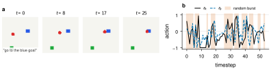

*Figure 3. **The toy world.** (a) Frames from one expert episode. The red dot must reach the goal named in the instruction ("go to the blue goal"); the other square is a distractor that only appears in the image. (b) Actions in one training episode: at each step there is a 30% chance of starting a burst of 1–3 random actions (shaded). Everything else comes from the expert.*

I could have started with a real robot benchmark. I deliberately didn't. To *understand* a world model I wanted three things a big benchmark doesn't give cheaply:

1. **Speed.** 400 episodes collect in a few seconds on a laptop.
2. **A fully known state.** The world is described by six numbers: position $(x, y)$, velocity $(v_x, v_y)$, and the instructed goal $(g_x, g_y)$. So "does the latent know where the robot is?" has an exact answer.
3. **A true simulator.** I can ask the model "what if I had pushed left?" *and* check its answer.

The physics is a point mass with momentum, in `envs/toy_point_env.py`:

$$v_{t+1} = 0.8\,v_t + 0.01\,a_t, \qquad p_{t+1} = \mathrm{clip}(p_t + v_{t+1}, 0, 1).$$

An episode succeeds when the agent is within 0.05 of the right goal **and** nearly stopped, so the expert (a simple PD controller) has to brake. One detail matters a lot later: **velocity is never drawn in the image.** Two frames with opposite velocities look identical.

**Exploration bursts.** The data collector in `scripts/collect_data.py` mostly runs the expert, but sometimes hands control to random actions for a few steps:

```python
if burst == 0 and rng.random() < args.random_action_prob:   # 0.3 by default
    burst = rng.integers(1, args.random_burst + 1)           # 1-3 steps
expert_step = burst == 0
...
is_expert.append(float(expert_step))
```

Every transition is tagged `is_expert`. The policy will only imitate expert steps; the world model learns from everything. Part 5 shows why this matters so much.

### 3.2 From pixels, words and numbers to one latent

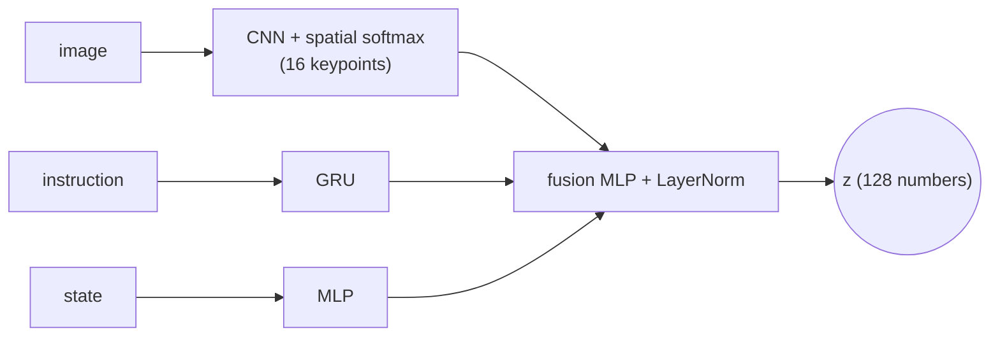

This part is a standard small VLA encoder, adapted from my earlier [mini-VLA](https://github.com/keivalya/mini-vla) project. The one twist is the image encoder. Instead of averaging the CNN's feature maps away (which throws away *where* things are), it ends in a **spatial softmax**: each of 16 feature maps becomes a probability map over the image, and its expected position becomes an $(x, y)$ "keypoint":

```python
def _expected_xy(self, attn):           # attn: (B, K, h, w), sums to 1 over (h, w)
    ys = torch.linspace(-1, 1, h)
    xs = torch.linspace(-1, 1, w)
    kp_x = (attn.sum(dim=2) * xs).sum(dim=-1)
    kp_y = (attn.sum(dim=3) * ys).sum(dim=-1)
    return torch.stack([kp_x, kp_y], dim=-1)    # (B, K, 2)
```

The nice side effect is that you can draw the keypoints on the image and *see* what the encoder looks at (Figure 12).

### 3.3 The policy head

The action head maps $z_t$ to an action. It's the same menu as in any VLA: a plain MLP regressor, a DDPM diffusion head, or a flow-matching head (`models/action_heads.py`). All three expose `loss(actions, z)` and `sample(z)`, so nothing else in the model cares which one you pick. All experiments here use the MLP head.

> **A diffusion detail that is easy to get wrong.** My first diffusion head used a linear noise schedule from $10^{-4}$ to $10^{-2}$ over 16 steps. That sounds reasonable, but it ends at $\bar\alpha_T \approx 0.92$: the "fully noised" action is still 92% signal. Sampling, though, starts from pure Gaussian noise the model never saw in training. Switching to a cosine schedule ($\bar\alpha_T \approx 10^{-5}$) and the proper DDPM posterior fixed it. If you build a diffusion head with few steps, check $\bar\alpha_T$.

### 3.4 The world model: twelve lines

Here is the entire world model, from `models/dynamics_head.py`:

```python
class LatentDynamicsMLP(nn.Module):
    def __init__(self, d_model, action_dim, hidden_dim=256):
        super().__init__()
        self.net = nn.Sequential(
            nn.Linear(d_model + action_dim, hidden_dim), nn.ReLU(),
            nn.Linear(hidden_dim, hidden_dim), nn.ReLU(),
            nn.Linear(hidden_dim, d_model),
        )
        self.ln = nn.LayerNorm(d_model)

    def forward(self, z, action):
        delta = self.net(torch.cat([z, action], dim=-1))
        return self.ln(z + delta)
```

Two small choices make it work:

- **It's residual.** Most of the world stays the same from one step to the next, so the network only has to predict the *change*.
- **It ends in a LayerNorm.** The encoder's latent also ends in a LayerNorm, so imagined latents stay on the same scale as real ones and long rollouts don't drift off to infinity.

### 3.5 Readouts: making the latent readable

A latent is useless to a human unless you can read it. picoWAM has two readouts, and both work on *any* latent, encoded from a real frame or imagined:

- **A linear state readout**, $\hat s = Wz + b$. I made it linear on purpose. If position and velocity can be recovered with a single linear layer, they are explicitly encoded in $z$, and the rows of $W$ tell you which directions mean what.
- **An image decoder** that turns $z$ back into a $64\times64$ picture. It predicts the *difference from the dataset's average image*, with no sigmoid at the end. Most pixels are static background, so the decoder starts out already drawing the background and spends its capacity on what moves. My first version used a sigmoid, got stuck, and was worse than just predicting the average image.

### 3.6 One training step

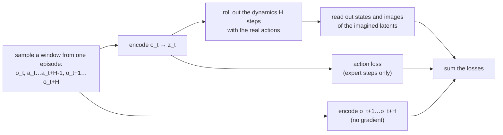

*Figure 4. One training step. The model sees only the first frame; it has to imagine the next H.*

For each training window of $H = 5$ steps:

1. Encode **only the first frame**, $o_t$, into $z_t$.
2. Roll the dynamics forward 5 steps with the actions that were really taken. The model never sees frames $o_{t+1}, \dots, o_{t+5}$.
3. Read out the state and image of every imagined latent and compare them with the truth.
4. Also encode the real future frames (without gradients) and pull the imagined latents toward them. This is **latent consistency**: it keeps imagined latents in the region where the readouts and the policy know what to do.
5. Add the imitation loss, but only on expert steps:

```python
expert = batch["is_expert"] > 0.5
action_loss = self.policy_head.loss(batch["action"][expert], z[expert])
```

In symbols:

$$\mathcal{L} = \mathcal{L}_{\text{act}} + w_s\,\mathcal{L}_{\text{state}} + w_i\,\mathcal{L}_{\text{image}} + w_z \cdot \tfrac1H \sum_k \|\hat z_{t+k} - \mathrm{sg}[\mathrm{enc}(o_{t+k})]\|^2,$$

with $w_s = 0.5$ and $w_i = w_z = 1$. Delete every term except $\mathcal{L}_{\text{act}}$ and you get the **VLA baseline**, with identical encoders. That's the comparison in every experiment.

### 3.7 Imagining and dreaming

Once trained, the model can roll forward in two ways. Both live in one function, `PicoWAMPolicy.imagine`:

```python
z = self.encode_obs(image, text_tokens, state)
for k in range(horizon):
    a = self.policy_head.sample(z) if actions is None else actions[:, k]
    z = self.dynamics(z, a)
```

- **Imagined**: you supply the actions. "Given these actions, what happens?" You can check the answer against the real episode.
- **Dreamed**: you pass `actions=None`, and the model's *own policy* chooses each action from its own imagined latent. Nothing from the real world is used after the first frame. "What do I think will happen if I act the way I would act?"

### 3.8 Run it yourself

```sh
pip install -r requirements.txt

# collect 400 episodes of the toy world (seconds)
python -m scripts.collect_data --env toy --episodes 400 --max-steps 80 --output-path data/toy.npz

# train the WAM (CPU is fine) and the VLA baseline
python -m scripts.train --dataset-path data/toy.npz --model_type wam --predict_state --predict_image \
  --epochs 15 --save-path checkpoints/wam.pt --device cpu
python -m scripts.train --dataset-path data/toy.npz --model_type vla --epochs 15 \
  --save-path checkpoints/vla.pt --device cpu

# how good is the imagination? what does the model believe?
python -m scripts.evaluate --checkpoint checkpoints/wam.pt
python -m scripts.visualize_rollout --checkpoint checkpoints/wam.pt --video

# closed loop, with a "mind's eye" video of what it expects next
python -m scripts.test --checkpoint checkpoints/wam.pt --episodes 20 --save-video
```

For the full study (three independent runs of everything): `bash scripts/run_toy.sh`.

---

## Part 4 — Does it actually imagine?

Every number from here on is measured on held-out episodes and averaged over three independent training runs, each with its own data and initialization. Figures show the spread across runs.

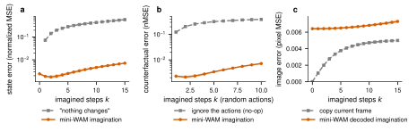

*Figure 5. **Imagined states are accurate and action-aware; imagined pixels are not.** (a) State error vs. how many steps the model imagines, compared with a lazy baseline that says "nothing changes". (b) The same under random actions, checked against the true simulator, compared with a baseline that ignores the actions. (c) Pixel error of the decoded imagination vs. just copying the current frame.*

- **States: yes.** After 15 imagined steps, the state error is $0.0071 \pm 0.0004$, about 80× lower than "nothing changes" ($0.582$).
- **Actions: yes.** Under random action sequences the expert never produced, the error after 10 steps is $0.0072$, versus $0.388$ for a model that ignores the actions. The world model knows what actions *do*.
- **Pixels: no.** The decoded frames are worse than just copying the current frame, at every horizon. Copying is a strong baseline when most of the image is static background.

Here's one episode, as the model sees it:

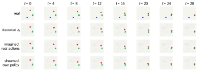

*Figure 6. Real frames; the decoding of each real frame's latent; an imagination from $t = 0$ with the real actions (the model never sees frames 1–28); and a dream, where its own policy acts. Notice what's missing from every decoded row: the blue distractor goal.*

The decoder draws the agent and the *instructed* goal, but drops the distractor. My best guess is that nothing the model needs depends on the distractor: the state readout only cares about the instructed goal. I haven't proven that, though.

And here's what the model believes over time, variable by variable:

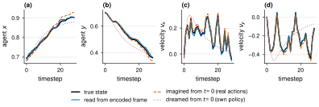

*Figure 7. Agent position and velocity over one held-out episode: the truth (black), the readout of each real frame's latent (blue), an imagination from $t = 0$ with the real actions (red dashed), and a dream with the model's own policy (purple dotted). The imagined velocity follows the noisy expert's every wiggle for 28 steps; the dream is smooth because the learned policy has no expert noise.*

**What if?** The question I most wanted to ask a world model is "what if I had done something else?" So I pushed it: from one start, imagine 15 steps of a constant push in every direction.

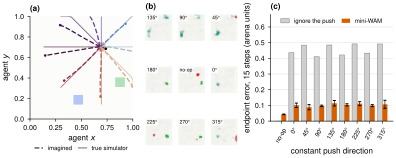

*Figure 8. (a) Imagined (dashed) vs. true (solid) trajectories for 15 steps of constant force in eight directions. (b) The decoded imagined frames at the end. (c) Endpoint error over all held-out episodes and runs, compared with a prediction that ignores the push.*

A 15-step constant push is far longer than any random burst in training (1–3 steps), so this is real extrapolation. The model gets the direction right but stops short. Its endpoint is off by $0.103 \pm 0.010$ (the arena is $1 \times 1$), against $0.457$ if you ignored the push. So it clearly uses the action, but it isn't exact when you take it far from its training data.

Finally, what does the latent space look like inside?

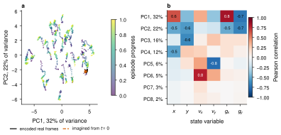

*Figure 9. (a) Held-out latents projected onto their first two principal components, coloured by episode progress. (b) How each principal component correlates with each state variable.*

The biggest directions in the latent mostly encode where the goal and agent are; velocity shows up only in smaller components (PC5–PC6). That's a useful reminder that PCA ranks directions by *variance*, not by importance. Goal location simply varies most across episodes.

---

## Part 5 — What worked and what did not

This is the part I'd want to read first if I were building my own WAM. Every row below is a real experiment.

| Decision | What I tried | What happened | Verdict |
|---|---|---|---|
| Training data | expert only vs. 30% random bursts | counterfactual error at 10 steps: $0.112 \rightarrow 0.0072$, even though factual error is *lower* with expert-only data | ✅ **diverse actions** |
| Imagination horizon $H$ | 1, 5, 10 steps | 10-step counterfactual error $0.0139 / 0.0072 / 0.0057$; one-step error $0.0019 / 0.0019 / 0.0030$ | ⚖️ **trade-off** |
| Latent consistency | on vs. off | 15-step error $0.0071 \pm 0.0004$ vs. $0.0096 \pm 0.0024$; one-step slightly better without it | ✅ **stability** |
| Image loss (state as input) | on vs. off | 15-step state error $0.0071$ vs. $0.0074$ | ➖ **not needed** here |
| Decoder output | sigmoid vs. residual on mean image | sigmoid got stuck; residual learns, but still worse than copying the frame | ⚠️ **pixels stay weak** |
| Image encoder | average pooling vs. spatial-softmax keypoints | keypoints barely move with state input; track the agent ($R^2 \ge 0.998$) without it | ✅ **only without state** |
| Diffusion head | linear vs. cosine noise schedule | linear never reaches noise; fixed with cosine + DDPM posterior | 🐛 **bug fixed** |
| Auxiliary supervision (pixels only) | BC, + current state, + future state | success $17.0\% / 28.4\% / 33.6\%$ | ⚠️ **mostly state supervision** |
| Few demonstrations | 25 to 400 episodes | WAM trails VLA at 25 episodes ($87\%$ vs. $99.7\%$); more updates close most of the gap | ⏳ **undertraining** |

### Lesson 1: expert-only data hides what actions do

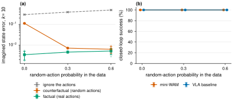

*Figure 10. (a) State error after 10 imagined steps as I add more random-action bursts. Green: factual (the recorded actions). Red: counterfactual (random actions, checked against the simulator). Grey: the error of ignoring the actions. (b) The policy doesn't care: success stays at 100%.*

This one surprised me the most. With expert-only data the world model's **factual** error is the *lowest* of all three settings. If that were the only metric you checked, you'd say expert-only data is best. But its **counterfactual** error is 15× worse ($0.112$ vs. $0.0072$).

Why? In expert data, the action is (almost) a function of the state: the expert always does roughly the same thing in the same situation. So the network can predict the future from the state alone, and never learns to read its action input. This is the world-model version of *causal confusion* in imitation learning ([de Haan et al.](https://doi.org/10.48550/arxiv.1905.11979)).

There's a twist I learned later. The expert data *does* contain enough information to identify the physics. A simple affine model of state and action, given the clipping rule, fits the transition to numerical precision from deterministic expert trajectories alone. So the problem is what the *neural* model chooses to learn, not what the data contains. Either way, the practical fix is cheap: mix in a few random actions, and tag them so the policy doesn't imitate them.

> **Takeaway.** Test your world model on actions the expert didn't take. Reconstruction or video quality on held-out demos is a *factual* metric, and it can look great while the model ignores the action. ([AD-WM](https://www.alphaxiv.org/abs/2609.30264) makes the same point for planning.)

### Lesson 2: you get good at the horizon you train on

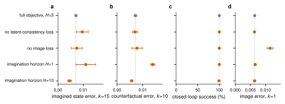

*Figure 11. Each row changes one thing from the full objective (grey). (a) State error after 15 imagined steps. (b) Counterfactual error after 10 random-action steps. (c) Closed-loop success.*

- Training on one-step windows ($H = 1$) gives the same one-step accuracy, but errors pile up: the 10-step counterfactual error doubles.
- Training on 10-step windows goes the other way: better far ahead, slightly worse one step ahead.

If you plan to imagine $k$ steps ahead, train on windows of about $k$ steps. GR-1 reports the same flavor of result for future-frame prediction. Latent consistency mostly buys *stability* across runs at long horizons. And with the state as an input, the image loss makes no measurable difference to how well the model predicts states.

### Lesson 3: an encoder learns to look only when it has to

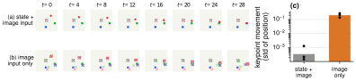

*Figure 12. Spatial-softmax keypoints on a held-out episode. (a) Model that also gets the state: the keypoints sit still near the image center. (b) Model that gets only the image: the keypoints follow the agent and mark both goals. (c) How much the keypoints move (log scale).*

When the robot state is given as input, the network already knows where everything is, so the image encoder has no reason to localize anything: its keypoints barely move. Remove the state, and they lock onto the agent ($R^2 \ge 0.998$ in every run). I like this result because it's a clean picture of *what the training signal forces the network to learn*.

### Lesson 4: prediction helps the policy when the observation hides something

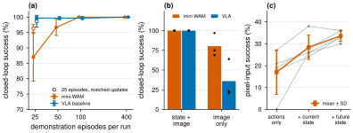

*Figure 13. (a) Success vs. number of demonstrations; open markers train longer to match the update count. (b) State + image input vs. image only. (c) A matched pilot: behavioral cloning, + current-state supervision, + future-state prediction. Each grey line is one run.*

- **With the state as input**, the WAM never meaningfully beats the VLA. Both hit 100%. With only 25 demos the WAM is *worse* (87% vs. 99.7%), but that is mostly undertraining: with matched updates it reaches 96.3% vs. 98.7%.
- **With pixels only**, the WAM wins every run: **80.3% vs. 36.0%**.

Why does the world model help so much here? This is where honesty matters. Two things change at once when you add the world-model losses: the network gets *state supervision* (it must know where the agent is now) and *future prediction* (it must know where it will be). A matched pilot, with identical data, initialization and updates, pulls them apart: cloning alone gets 17.0%, adding current-state supervision gets 28.4%, and adding future-state prediction gets 33.6%. **Most of the gain is state supervision.** Predicting the future adds a smaller and less consistent bump: it helps in four of five runs.

And about velocity: in the image-only model, a linear readout recovers position from one frame almost perfectly ($R^2 \approx 0.99$) but velocity only partly ($R^2 \approx 0.5$). That makes sense, since velocity isn't in the image. After a few imagined steps the velocity readout improves a lot ($R^2 \approx 0.9$). Tempting as it is to say "imagination recovers the hidden velocity", the honest reading is narrower. Velocity uncertainty shrinks on its own under this physics ($0.8^k$ damping), and the rollout is fed the real actions. The deployed policy also never uses the imagined latents; it re-encodes one frame every step. So the improvement is real, but the mechanism isn't settled. A policy with a short frame history might close much of the gap without any world model.

---

## Part 6 — Where the cost goes

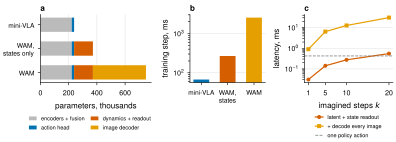

*Figure 14. (a) Parameters per module. (b) Time for one training step (batch 64). (c) Time to imagine k steps, with and without decoding images, compared with the time for one policy action. Measured on one CPU thread of a laptop.*

- **Acting is free.** WAM and VLA both take 0.42 ms per action, because the deployed policy never calls the world model.
- **Training is not.** One WAM training step costs 38× a VLA step. Remove the image decoder and the step drops from 2.55 s to 0.27 s (9.5× cheaper), while the parameter count halves. The decoder holds half the parameters and about 90% of the training compute.
- **Imagination is cheap, pictures aren't.** Ten imagined latent steps with state readouts take 0.28 ms; decoding an image at every step raises that to 12.7 ms.

If you want your WAM to be fast:

1. **Predict states or compact latents before pixels.** That's where the cost is, and in this task pixels didn't even help the state predictions.
2. **Keep small datasets on the GPU** and build batches by indexing, not with a per-sample loader. Even on a CPU this cut batch assembly from 4.5 ms to 2.6 ms; on a cluster node with one CPU core, the per-sample loader was the bottleneck.
3. **Roll out in latent space**, and decode only when you actually want to look.

---

## Part 7 — Honest limitations

- **It's a toy.** A 2D point mass with two goals, smooth physics, and (when the state is given) full observability. Contact, occlusion and long horizons, where WAMs should matter most, are absent.
- **No planning.** The policy acts reactively from the current latent. The world model shapes training, and I use `imagine()` for analysis, but nothing here measures planning.
- **Privileged supervision.** In the pixel-only setting the WAM still learns from true-state targets during training, and I haven't compared it with a policy that sees a short frame history.
- **Small numbers of runs.** Three independent runs per configuration (five in the pilot) are enough to see big effects, not small ones.

---

## Part 8 — Try it yourself

Some exercises, in rough order of difficulty. Everything you need is already in the code.

1. **Break it on purpose.** Set `RANDOM_ACTION_PROB=0.0` in `scripts/run_toy.sh` and look at `4_what_if.png` from `visualize_rollout.py`. Do the imagined pushes still fan out?
2. **Change the horizon.** Train with `--horizon 1` and `--horizon 10` and compare the "what if" plots.
3. **Plan with the world model.** Sample 64 random action sequences, imagine each with `model.imagine(..., actions=...)`, score each by the distance between the imagined agent and the goal, and execute the first action of the best one. Does this beat the policy when you remove the state input?
4. **Give the policy memory.** Stack the last two frames as input and rerun the image-only comparison. How much of the WAM's advantage survives?
5. **Go real.** `collect_data.py` and `test.py` already support Meta-World (`--env metaworld`). What breaks first?

---

## Glossary

- **Behavioral cloning (BC):** training a policy to copy expert actions, as supervised learning.
- **Counterfactual prediction:** predicting what *would* happen under actions that were not taken.
- **Factual prediction:** predicting what *did* happen, given the recorded actions.
- **Imagination / rollout:** applying the dynamics model repeatedly without new observations.
- **Inverse dynamics:** inferring the action that moved the world from one state to the next.
- **Latent ($z$):** the network's internal summary vector.
- **Linear probe / readout:** a single linear layer that reads a property (like position) out of a latent.
- **MPC (model-predictive control):** planning by imagining candidate action sequences with a model and executing the first action of the best one.
- **Spatial softmax:** turning a feature map into the expected $(x, y)$ position of its activation.
- **VLA:** vision-language-action model, a policy that maps images and instructions to actions.
- **WAM:** world action model, a policy that also predicts how its actions change the world.

## FAQ

**Do I need a GPU?** No. Everything here trains on a laptop CPU; the study ran on single cluster GPUs only to get through 12 experiments × 3 runs quickly.

**Why not just use a big pretrained WAM?** You should, for real robots. But at billions of parameters it's hard to see *why* things work. picoWAM is for building intuition that you can carry back to the big models.

**Is the world model ever used when the robot acts?** Not in these experiments. It's a training signal and a tool for analysis. Using it to plan is exercise 3.

**What's the difference between "imagined" and "dreamed"?** Imagined uses actions you provide (usually the real ones); dreamed lets the model's own policy pick actions inside its imagination.

---

## Reproducing everything

```sh
bash scripts/run_toy.sh   # 3 runs: collect, train WAM + VLA, evaluate, test, visualize, summarize
```

Every experiment is `scripts/run_toy.sh` with **one line** of its configuration block changed:

| Experiment | Change | Results |
|---|---|---|
| baseline | none | `docs/results/baseline` |
| expert-only data | `RANDOM_ACTION_PROB=0.0` | `docs/results/explore-0.0` |
| more exploration | `RANDOM_ACTION_PROB=0.6` | `docs/results/explore-0.6` |
| no latent consistency | `LATENT_WEIGHT=0.0` | `docs/results/no-latent` |
| no image loss | `IMAGE_WEIGHT=0.0` | `docs/results/no-image` |
| horizon 1 / 10 | `HORIZON=1` / `HORIZON=10` | `docs/results/horizon-1`, `horizon-10` |
| fewer demos | `EPISODES=25` / `50` / `100` | `docs/results/episodes-*` |
| 25 demos, matched updates | `EPISODES=25`, `EPOCHS=225` | `docs/results/episodes-25-matched` |
| image + language only | `STATE_INPUT=0` | `docs/results/image-only` |

The matched supervision pilot and the affine audit live in `docs/results/supervision-pilot` and `docs/results/research-audit`, with their own READMEs. The efficiency numbers come from `docs/figures/benchmark_efficiency.py`, and every figure is rebuilt by `python docs/figures/make_figures.py`.

## References

1. Assran, M. et al. *V-JEPA 2: Self-Supervised Video Models Enable Understanding, Prediction and Planning.* 2025. [alphaXiv](https://www.alphaxiv.org/abs/2506.09985)
2. Cen, J. et al. *WorldVLA: Towards Autoregressive Action World Model.* 2025. [alphaXiv](https://www.alphaxiv.org/abs/2506.21539)
3. Chen, J. et al. *MiniWAM: Learning Compact Future Targets for Efficient World-Action Modeling.* 2026. [alphaXiv](https://www.alphaxiv.org/abs/2610.12194)
4. de Haan, P., Jayaraman, D. & Levine, S. *Causal Confusion in Imitation Learning.* 2019. [doi](https://doi.org/10.48550/arxiv.1905.11979)
5. Huang, S. et al. *Nano World Models: A Minimalist Implementation of Future Video Prediction.* 2026. [alphaXiv](https://www.alphaxiv.org/abs/2605.23993)
6. Jang, J. et al. *DreamGen: Unlocking Generalization in Robot Learning through Video World Models.* 2025. [alphaXiv](https://www.alphaxiv.org/abs/2505.12705)
7. Kim, M. J. et al. *Cosmos Policy: Fine-Tuning Video Models for Visuomotor Control and Planning.* 2026. [alphaXiv](https://www.alphaxiv.org/abs/2601.16163)
8. Li, L. et al. *Causal World Modeling for Robot Control* (LingBot-VA). 2026. [alphaXiv](https://www.alphaxiv.org/abs/2601.21998)
9. Liao, Y. et al. *Genie Envisioner: A Unified World Foundation Platform for Robotic Manipulation.* 2025. [alphaXiv](https://www.alphaxiv.org/abs/2508.05635)
10. Lu, Z. et al. *World-Action Models for Robot Learning and Control: A Survey.* 2026. [alphaXiv](https://www.alphaxiv.org/abs/2609.16074)
11. Qiu, J. et al. *AD-WM: Action-Discriminative World Models for Counterfactual Model Predictive Control.* 2026. [alphaXiv](https://www.alphaxiv.org/abs/2609.30264)
12. Shen, Q. et al. *World Action Models: A Survey.* 2026. [alphaXiv](https://www.alphaxiv.org/abs/2606.20781)
13. Wu, H. et al. *Unleashing Large-Scale Video Generative Pre-training for Visual Robot Manipulation* (GR-1). 2023. [alphaXiv](https://www.alphaxiv.org/abs/2312.13139)
14. Zhang, X., Zeng, X. & Zhang, W. *From World Models to World Action Models: A Concise Tutorial for Robotics.* 2026. [alphaXiv](https://www.alphaxiv.org/abs/2607.00836)
15. Zhu, C. et al. *Unified World Models: Coupling Video and Action Diffusion for Pretraining on Large Robotic Datasets.* RSS 2025. [doi](https://doi.org/10.15607/rss.2025.xxi.015)
